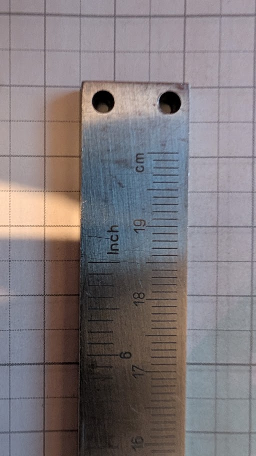
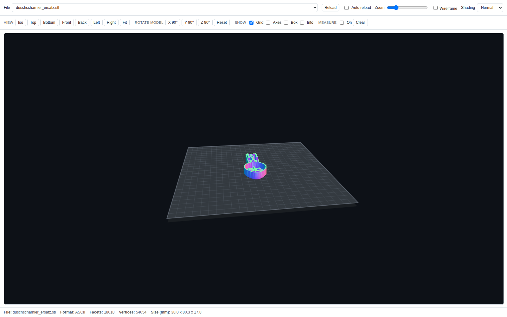

# 3D Printing Models

A collection of ASCII STL models for the Anycubic Kobra S1 Combo + ACE Pro (250 × 250 mm build plate).

## Models

| File | Description |
|------|-------------|
| `models/wedge_100x20x40.stl` | 100 × 20 × 40 mm wedge |
| `models/lineal-clip-kappe.stl` | Snap-fit clip cap for the two holes at the end of a steel ruler ([see example](#example-from-photo-to-printable-stl)) |
| `models/duschscharnier_ersatz.stl` | Shower-door hinge replacement body generated from `scripts/duschscharnier_ersatz.py` |
| `models/waeschespinne-reduzierring-67-50.2.stl` | ASA reducer ring for a confirmed 67.0 mm sleeve bore and 50.2 mm laundry-line pole; 77 mm retaining collar ([dimensions](docs/waeschespinne-reduzierring-masse.md)) |
| `models/zylinder_scheibe_2026_2027.stl` | Cylindrical/washer-style reference part |
| `models/lampe-5-rahmen.3mf` | Multi-material frame for the 240 mm number-5 wall lamp |
| `models/lampe-5-leuchtflaechen.stl` | All four translucent lamp panels arranged together on the 250 × 250 mm bed |
| `models/modellauto-reifen.stl` / `models/modellauto-reifen-print.3mf` | Completed PLA toy-car replacement tyre, 37.2 mm diameter × 26 mm width ([3MF project preview](docs/images/modellauto-reifen-print-preview.png)); [archived measurements and print notes](docs/modellauto-reifen-masse.md) |
| `models/ghouls-grip-view.3mf` | Assembled multi-material view on three plates: deployed, intermediate at a 48° scissor angle, and retracted ([project preview](docs/images/ghouls-grip-view-preview.png); [dimensions and assembly](docs/ghouls-grip-masse-und-bauanleitung.md)) |
| `models/ghouls-grip-print.3mf` | One settings-bearing OrcaSlicer project with four PLA color/spool assignments and 37 objects on four plates ([all-plate preview](docs/images/ghouls-grip-print-preview.png)). The 27 natural-white mechanism parts share one plate; rebuilt open floor-bearing yokes clear the unchanged arms in all 61 states. See [slice/profile status and physical fit risks](docs/ghouls-grip-druckvalidierung.md). |
| `models/ghouls-grip-preview.stl` | Deployed assembly-only multi-body preview; printable parts regenerate from `scripts/` |
| `model-sources/ghouls-grip/ghouls-grip-master.blend` | Blender CLI/MCP scene checkpoint; technical objects are frozen and organic objects are separately marked |

### The Ghoul's Grip: final project contract

The original spring, rubber-band, tendon and latch concept was replaced by a
fully rigid, manually reversible mechanism:

`rotating skull knob -> rack-and-pinion slider -> dual scissor lift + lid linkage + five-gear forearm drive`

The closed box contains the complete mechanism. The internal lid rack, follower
and crank sit below a sealed black service hood with a continuous 2.0 mm roof;
only its assembly cavity opens toward the inside of the chest. The intended
external skull knob remains accessible at the front.

The current user-edited print project contains **37 physical objects on four plates**.
The file has been sliced with OrcaSlicer CLI 2.4.2; its saved profile settings
differ from repository defaults, so print-profile compliance is not verified.

| Plate group | Plates | Main contents | Slice material / support / time |
| --- | ---: | --- | ---: |
| Black PLA | 1 | chest and lid | 338.28 g / 7.16 g / 12 h 09 min 59 s |
| Bone-beige PLA | 1 | forearm, palm, five flexure fingers | 43.51 g / 5.90 g / 3 h 04 min 12 s |
| Natural-white PLA | 1 | all 27 mechanism parts, gears, shafts and pivot pins | 122.82 g / 13.33 g / 5 h 08 min 18 s |
| Gray PLA | 1 | anatomical skull drive knob | 24.05 g / 3.40 g / 1 h 11 min 05 s |
| **Total** | **4** | **37 print objects** | **528.66 g / 29.79 g / 21 h 33 min 34 s** |

Floor-bearing repair: two 4 mm cheeks around each open 12 mm arm channel,
unchanged pivots and arm geometry. Actual per-arm/chest Boolean volumes are
0.000 mm³ to three decimals across 18–78° (maximum numerical residual
0.000020464 mm³, acceptance tolerance 0.001 mm³). The 16 former connector-plate
objects now share the mechanism plate with the 11 main parts; the complete
37-object BOM remains intact. All 36 unaffected mesh payloads remain unchanged.
The floor pins insert from the chest centre; dimensions introduced for clearance
and strength are design estimates requiring a physical PLA fit/load test.
Profile compliance remains **not-verified**, not print-ready.
Complex projects follow the two-file convention: `-view.3mf` is the assembled
overview (with additional state plates for mechanisms), and `-print.3mf` is the
single all-material print project. Same-color parts share plates when safe;
additional plate count never creates additional print-project files.

All generated OrcaSlicer projects use these repository defaults unless a
documented part-specific override is required:

- seam position: **Random** (`seam_position=random`)
- ironing: **All top surfaces** (`ironing_type=top`)
- automatic supports: **enabled** (`enable_support=1`)
- Textured PEI plate, 0.4 mm nozzle, 0.20 mm layer height
- XY hole compensation 0.10 mm and elephant-foot compensation 0.15 mm

Support is deliberately left enabled. A zero-support result must come from
self-supporting geometry and a successful slice, never from switching support
generation off. The exact per-plate support quantities and measured orientation
comparisons are recorded in
[`docs/ghouls-grip-druckvalidierung.md`](docs/ghouls-grip-druckvalidierung.md).
Every 3MF also has a complete-project preview at
`docs/images/<3mf-stem>-preview.png`. After a successful slice, each sliced plate
has a G-code-derived support screenshot at
`docs/images/<3mf-stem>-plate-<n>-supports.png`; both the Canvas and Web viewer
provide buttons for these images, including in the expandable per-plate details.
The current print-project preview shows all four plates and their material
grouping:


Assembly order, connector use and dimensions are in
[`docs/ghouls-grip-masse-und-bauanleitung.md`](docs/ghouls-grip-masse-und-bauanleitung.md);
the full swept-volume proof is in
[`docs/ghouls-grip-mechanik-verifikation.md`](docs/ghouls-grip-mechanik-verifikation.md).

## Setup

Python tooling for parametric model generation lives in a project-local virtual environment:

```powershell
python -m venv .venv
.\.venv\Scripts\python.exe -m pip install -r requirements.txt
```

Generator scripts live in `scripts/` and write their output to `models/`:

```powershell
.\.venv\Scripts\python.exe scripts\lineal_clip_kappe.py
```

The final print gate uses OrcaSlicer's official CLI. `.vscode/mcp.json` supports
the official Blender Lab MCP through a user-local `BLENDER_MCP_DIR`, bound to
`127.0.0.1:9876`. The third-party OrcaSlicer MCP entry remains disabled; official
Orca CLI slicing is authoritative. See [`docs/mcp-setup.md`](docs/mcp-setup.md).
Render complete 3MF project previews with
`.\.venv\Scripts\python.exe scripts\render_3mf_previews.py`; after a successful
plate slice, render color-coded plate previews and G-code support-path screenshots
with the corresponding scripts in `scripts/`.
Printer control remains disabled unless explicitly requested.

## Example: From Photo to Printable STL

This walkthrough shows how the skills in this repo turn a photo plus a couple of
measurements into a validated, printable STL. The example produces
`models/lineal-clip-kappe.stl` — a small cap that clicks into the two holes at the
end of a steel ruler.

### 1. Provide a photo with a scale reference

Place the object on graph paper (or next to a ruler/coin) so the agent can derive a
scale. Here the 5 mm grid **and** the ruler's own cm scale give two independent
references:



Then describe the intent, e.g.:

> Create an STL file:
> - the object should be a narrow rectangle that sits on top of the two holes
> - it should have two bumps that fit exactly into the holes so it clicks in

### 2. The agent derives measurements from the image

When several reference photos exist, the agent first builds a numbered contact sheet
so it can pick the right photo instead of opening all of them at full resolution:

```powershell
.\.venv\Scripts\python.exe scripts\make_contact_sheet.py model-sources
```

This writes `model-sources/_index.png` plus an index-to-path legend; measurements are
then taken from the full-resolution tiles that actually show the feature.

Once a model is finished, the raw reference photos are deleted and only the contact
sheet is kept, renamed after the model, under `model-sources/archiv/`
(see `model-sources/archiv/README.md` for the tile-to-file legend).

The `stl-from-image-measurements` skill scales the image and reports what is measured
versus inferred:

| Dimension | Value | Source |
|-----------|-------|--------|
| Ruler width | 14.5 mm | image scaling (5 mm grid ≈ 14.4 px/mm) |
| Hole diameter | 2.5 mm | image scaling |
| Hole spacing (centre-to-centre) | 9.1 mm | image scaling |
| Hole centre from top edge | 3.2 mm | image scaling |
| Material thickness | 2.0 mm | **user supplied** (not visible from a top view) |

### 3. Confirm the fit-critical values

Anything that controls a fit is confirmed before geometry is built. In this run the
agent asked three targeted questions:

1. Are the estimated hole diameter / spacing / width correct? → *accept estimates*
2. How thick is the ruler? → *2.0 mm*
3. How should the bumps engage? → *snap hooks with a retaining lip (audible click)*

### 4. Geometry is generated as a parametric script

`scripts/lineal_clip_kappe.py` builds the solid with `trimesh` + `manifold3d` booleans,
so every dimension stays editable:

- Plate: 14.5 × 7.0 × 2.0 mm
- Peg shaft ⌀2.30 mm = 2.5 mm hole − 0.20 mm press-fit clearance
- Shaft length 2.0 mm (= material thickness), then a ⌀3.00 mm barb with a 0.35 mm retaining ledge
- 1.4 mm lead-in cone (≈34°) for easy insertion
- 0.6 mm compliance slot per peg → two 0.85 mm spring legs so it actually snaps

### 5. Validate and preview

The `validate-stl-mesh` checks must all pass before the file is considered done:

```
facets: 972
extents: [14.5, 7.0, 5.4]
watertight: True
winding_consistent: True
euler: 2
degenerate: 0
volume_mm3: 217.761
```

The result is then opened in the new STL Canvas SPA (GitHub Pages), which uses
the same renderer as the GitHub Copilot App canvas extension — shown here with
the **Normal** shader and fully zoomed to the model:



### 6. Print orientation

The model is exported in its print orientation: plate flat on the bed, snap pegs
pointing up (+Z). No supports are needed — the only overhang is the 0.35 mm retaining
ledge. In use the part is flipped and pressed onto the ruler.

### 7. Iterate

If the fit is too tight or too loose, adjust `HOLE_DIA` / `PRESS_CLEAR` in
`scripts/lineal_clip_kappe.py` and re-run the script instead of editing the mesh.

## Agent Skills

| Skill | Description |
|-------|-------------|
| `anycubic-kobra-s1-ace-pro-profile` | Printer defaults and constraints (bed size, nozzle, temperatures, wall minimums) for the Anycubic Kobra S1 Combo + ACE Pro. Referenced by other skills when authoring or editing STL/3MF outputs. |
| `create-ascii-stl` | Generates new printable geometry with print-safe defaults. Collects dimensions, material, use case, and material/color-semantics intent before producing geometry; enforces 3MF when distinct material/color regions must be preserved. |
| `edit-stl-transform` | Edits existing STL geometry: scale, rotate, translate, merge, split, and origin alignment — while preserving manifold/watertight topology. |
| `stl-create-edit-interview` | Guided interview run before creating or editing STL/3MF outputs. Determines wall strategy, mesh pattern, infill strategy, fit intent, and material-semantics/output-format decisions one question at a time. |
| `image-relief-vectorize` | Conditionally converts noisy reference photos into a relief/height-like image and a cleaned vector-style contour when a pictured object itself must be reconstructed. |
| `photo-anchor-candidate-fit` | Refines an existing model toward image references by freezing trusted geometry, branching controlled candidates, and comparing them against calibrated landmarks. |
| `visual-hull-envelope-fit` | Uses multiple accepted silhouettes or views to constrain the outer envelope before rebuild or refinement. |
| `partial-rebuild-instead-of-mutate` | Rebuilds one wrong local region from a stable boundary instead of continuing to mutate a drifting model. |
| `stl-from-image-measurements` | Creates or edits STL/3MF outputs from user photos plus measurements: identifies the whole shape first, researches existing models, applies reuse-vs-segmentation strategy, derives scale from reference objects, and validates against printer constraints. |
| `research-part-specs` | Sources real published dimensions for an identifiable product before modeling, records origin/source/confidence per value in `docs/`, and forbids invented fit-critical numbers. |
| `research-reusable-3d-assets` | Always searches for exact or similar reusable models before nontrivial original construction, verifies modification/redistribution rights, records attribution, and chooses reuse, hybrid, reference-only, or rebuild. |
| `blender-assisted-modeling` | Routes organic and visually complex geometry through a controlled local Blender/MCP workflow while freezing technical datums and revalidating every export. |
| `validate-stl-mesh` | Validates an STL for manifold correctness and FDM printability: syntax, triangle count, watertight topology, normal consistency, and bed-fit. |
| `optimize-stl-for-print` | Optimizes a correct mesh for printing: orientation for load direction, overhang and bridge reduction, hole/elephant-foot compensation, bed layout and filament estimate. |
| `orcaslicer-support-minimization` | Compares stable-datum orientation candidates in OrcaSlicer to minimize support while preserving Kobra S1 profiles, material grouping, plate semantics, strength, fit, and source STL authority; geometry changes remain suggestions only. |
| `orcaslicer-print-validation` | Performs the final slicer gate and records exact profiles, print time, material use, supports, warnings, status, and plate previews. |
| `multimaterial-assembly-packaging` | Builds one assembled multi-state view 3MF and one consolidated print 3MF with all plates, favoring keyed separately printed color parts to reduce purge waste. |
| `.github/skills/README.md` *(meta)* | Skills library index for reusable procedures: which rules are maintained in which skills and how new findings should be categorized. |

## Central consistency matrix

| Concern | Primary skill | Rule |
| --- | --- | --- |
| Fit-critical dimensions | `research-part-specs` | Never invent fit-critical dimensions; use measured or cited values and record them in `docs/`. |
| Photo-driven reconstruction | `stl-from-image-measurements` | Image-driven workflows apply only when reconstructing a pictured object or motif. |
| Free-design / no-original parts | `create-ascii-stl` | Do not force photo-tracing workflows onto invented or function-first parts. |
| Relief-first contour extraction | `image-relief-vectorize` | Traced contours are candidate outlines only, not authority for fit-critical geometry. |
| Anti-drift model refinement | `photo-anchor-candidate-fit` | Freeze trusted datums and compare branched candidates from one baseline instead of chaining STL tweaks. |
| Multi-view outer-envelope recovery | `visual-hull-envelope-fit` | Use silhouette-derived hulls only to constrain outer envelopes, not hidden or mating geometry. |
| Partial rebuild | `partial-rebuild-instead-of-mutate` | If one local region is structurally wrong, rebuild that region from a stable script boundary instead of continuing mutation. |
| Source of geometry edits | `create-ascii-stl` | Regenerate from parametric scripts in `scripts/`; do not hand-edit STL facets. |
| STL vs 3MF | `stl-create-edit-interview` | Distinct material/color regions require a 3MF deliverable; STL is only for merged single-region output. |
| Coordinate convention | `validate-stl-mesh` | Auto-detect center-origin vs corner-origin unless the user specifies it. |
| Feature proof | `validate-stl-mesh` | Use probes, slices, and compare checks instead of screenshots alone. |
| Final model image in chat | `create-ascii-stl` | Post an inline render of the exact final STL/3MF in the final chat response; a canvas preview or path alone is not enough. |
| Canvas preview | `create-ascii-stl` | Also preview written STL files from `models/`; for 3MF-first outputs, report the 3MF path and preview an STL counterpart when available. |
| Reusable model assets | `research-reusable-3d-assets` | Always search exact and similar templates before nontrivial original modeling and use only assets with documented, compatible modification and redistribution rights. |
| Python vs Blender | `blender-assisted-modeling` | Python owns fit-critical geometry; Blender owns approved organic and visual regions, followed by independent export validation. |
| Delivered-project support minimization | `orcaslicer-support-minimization` | Compare candidates from one frozen baseline, run OrcaSlicer sequentially, preserve materials/plates, and write the selected transform to 3MF rather than overwriting a generator STL. |
| Final slicing | `orcaslicer-print-validation` | Do not claim print time or final print readiness without a successful slice using the intended profiles. |
| Complex and multicolor packaging | `multimaterial-assembly-packaging` | Deliver exactly one multi-state `-view.3mf` and one all-plates `-print.3mf`; group same-color parts on shared plates and prefer keyed color bodies when practical. |

## Blender and OrcaSlicer workflow

Technical features, dimensions, fits, joints and clearances remain parametric in
Python. Organic or visually complex regions may be authored or refined in Blender.
Use Blender CLI for deterministic scene builds, batch import/export and renders,
and the official local Blender Lab MCP for bounded interactive inspection and
visual edits. The two paths may be combined, but Blender exports are always treated
as external meshes and must pass the same scale, topology, feature and render
checks as any downloaded model.

Every new complex assembly is delivered as `models/<name>-view.3mf` plus one
`models/<name>-print.3mf`. The view file contains the assembled object, with
meaningful mechanism states on additional plates; the single print project
contains all material/spool mappings and print plates, grouping same-color parts
when safe. OrcaSlicer is the final print gate: each print plate is sliced with
the intended Kobra S1, nozzle, process and filament profiles, and the resulting
print time, material estimate, supports and warnings are documented. When colors
can be separated without unacceptable loss of appearance or strength, keyed
separately printed bodies are preferred over purge-heavy in-place multicolor
printing.

The project MCP template is `.vscode/mcp.json`. Blender uses the official Blender
Lab MCP server through a local `uv` installation. OrcaSlicer is configured as an
opt-in, disabled-by-default template because the official OrcaSlicer integration is
its CLI rather than a first-party MCP server. See
[`docs/mcp-setup.md`](docs/mcp-setup.md) before enabling either integration.

## Mesh CLI

`scripts/mesh_tool.py` is the shared command-line companion for the skills above.
It uses `trimesh` + `manifold3d`, always writes ASCII STL, and knows the 250 × 250 mm
bed and both coordinate conventions.

```powershell
.\.venv\Scripts\python.exe scripts\mesh_tool.py info     models\lineal-clip-kappe.stl
.\.venv\Scripts\python.exe scripts\mesh_tool.py validate models\lineal-clip-kappe.stl
.\.venv\Scripts\python.exe scripts\mesh_tool.py overhang models\lineal-clip-kappe.stl
.\.venv\Scripts\python.exe scripts\mesh_tool.py measure  models\lineal-clip-kappe.stl --infill 20
```

| Command | Purpose |
|---------|---------|
| `info` / `validate` | mesh stats, watertightness, Euler number, degenerate faces, bed placement |
| `repair` | lossless repair recipe for OCCT/build123d exports (no `pymeshfix`) |
| `measure` | bounding box, volume, mass and filament length estimate |
| `center` / `transform` | bed centering per convention, scale/rotate/translate/fit |
| `boolean` | union/difference/intersection via the manifold engine |
| `probe` / `slices` | prove a feature exists (volume probe, cross-section sweep) |
| `overhang` | unsupported area for the current print orientation |
| `arrange` | lay several parts out on the build plate |
| `compare` | compare the same model across worktrees before trusting a bug report |

## Web app: "3d-printing model viewer"

Die GitHub-Pages-SPA ist jetzt ein schlanker STL/3MF-Viewer für Dateien aus
`models/`. Sie verwendet denselben Browser-Renderer wie die Copilot-Canvas-
Erweiterung, zeigt also lokale Vorschauen konsistent im Web und im Agent-UI an.

### Funktionen

- 3D-Vorschau für **STL und 3MF** aus `models/`
- Mehrplattige 3MF-Dateien öffnen standardmäßig mit **All plates**:
  alle Platten mit Projekt-Gesamtwerten und Plattenzahl.
  Build-/Komponenten-Transformationen und OrcaSlicer-`plater_id` bleiben
  erhalten; mehr als zwei Platten werden nur in der Gesamtansicht in einem
  Grid mit Abstand angeordnet. Zwei Platten stehen nebeneinander.
  Einzelplatten bleiben auswählbar; Reload derselben Datei behält die Auswahl,
  ein Dateiwechsel setzt sie auf **All plates** zurück.
- Materialfarben aus OrcaSlicers Filamentpalette und Objekt-/Teilzuweisungen;
  Standard-3MF-Materialfarben bleiben der Fallback für andere 3MF-Dateien.
- kompakte, ständig sichtbare Druckübersicht für Zeit, Gesamtmaterial,
  Stützmaterial, Filamentlänge und Validierungsstatus **aller Plates**,
  auch wenn eine einzelne Plate ausgewählt ist
- einklappbares Detail-Overlay rechts unten mit Profil, Farbe, Bett, Wänden,
  Infill, Supportart, Plattenzahl und vollständigen Projektmetadaten sowie
  einer separat aufklappbaren Tabelle **Print data by plate** mit Druckzeit,
  Material, Stützmaterial, Filamentlänge und Status pro Plate
- ein einziges einklappbares Menü für Reload/Auto-Reload, Zoom, Shading,
  Wireframe, Ansichten, Modellrotation, Hilfsanzeigen und Messwerkzeuge
- lokaler Canvas-Button **Open in OrcaSlicer**, der genau die aktuell gewählte
  Workspace-3MF über den validierten lokalen Launcher öffnet
- direkter Download der aktuell gewählten Datei
- GitHub-Link zurück zum Repository
- Button für ein neues Modell-Ticket über
  `.github/ISSUE_TEMPLATE/model-request.yml`

Die Web-SPA und die Copilot-Canvas-Erweiterung teilen Renderer und Layout. Der
OrcaSlicer-Launcher ist nur in der lokalen Extension verfügbar; die öffentliche
Webseite kann keine lokale Desktop-Anwendung starten.

Auf Mobilgeräten verwendet die Seite ein reduziertes Canvas-Pixelverhältnis und
deaktiviert das frühere automatische Polling, damit große Modelle spürbar
schneller geladen und gerendert werden.

### Neues Modell anfragen

Für neue Teile oder fit-kritische Änderungen öffne ein Issue über das Template
`.github/ISSUE_TEMPLATE/model-request.yml` und hänge dort Fotos, Maße in mm,
Material-/Farbhinweise und die Definition of Done an.

### PR-Ausgabe für Modellarbeit

PRs, die aus solchen Modell-Issues entstehen, sollen
`.github/pull_request_template.md` verwenden. Die Vorlage fordert:

- genaue Pfade der geänderten Skripte/Modelle/Dokumente
- Validierungsbefehle und Mesh-Ergebnisse
- gerenderte Vorschaubilder bzw. Slicer-Previews für das finale STL/3MF
- Kennzeichnung von Schätzungen und verbleibendem Testdruck-Risiko

## Coordinate Convention

Models support both placement conventions on the 250 × 250 mm bed:

- **Center-origin** — XY target `(0, 0)`
- **Corner-origin** — XY target `(125, 125)`

Convention is auto-detected from coordinates: negative XY implies center-origin, otherwise corner-origin. When ambiguous, corner-origin is used to match common slicer build-plate coordinates.

## Third-party geometry and attribution

The skeleton hand of the Ghoul's Grip is derived from
**"Wrist Bones Full Hand - Human Skeleton"**, NIH 3D Print Exchange model
`3DPX-016815` by *My Segmenter* (mysegmenter.com), licensed **CC BY**.

Only the derived, classified and decimated bone set
`model-sources/ghouls-grip/reference/hand_bones.npz` is committed;
`scripts/extract_hand_bones.py` re-downloads the 12 MB source STL on demand.
Redistributing the Ghoul's Grip models must keep this attribution.
