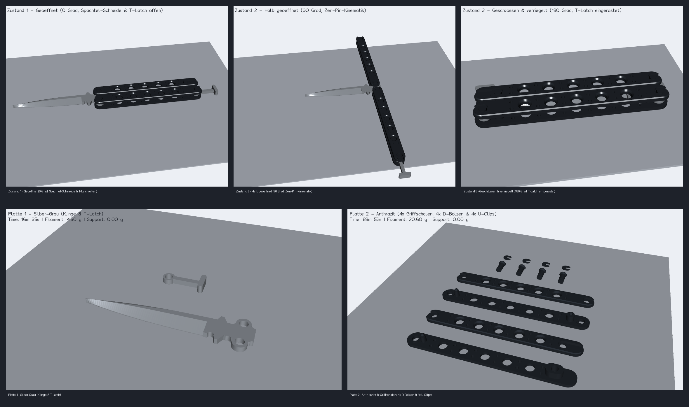

# Butterfly-Messer (`butterfly-messer`): OrcaSlicer-Druckvalidierung

## 1. Projekt- und Profilübersicht (`orcaslicer-print-validation`)

- **Druckprojekt:** [`models/butterfly-messer-print.3mf`](../models/butterfly-messer-print.3mf)
- **Ansichtsprojekt (3 Zustände):** [`models/butterfly-messer-view.3mf`](../models/butterfly-messer-view.3mf) (`0°` Geöffnet, `90°` Flip-Bewegung, `180°` Geschlossen & verriegelt)
- **Einzel- und Vorschau-STLs:** [`models/butterfly-messer.stl`](../models/butterfly-messer.stl) sowie 14 druckorientierte Einzelteil-STLs `models/butterfly-messer-*.stl`
- **OrcaSlicer-Version:** OrcaSlicer CLI `2.3.2` (`C:\Program Files\OrcaSlicer\orca-slicer.exe`)
- **Druckerprofil:** `Anycubic Kobra S1 0.4 nozzle`
- **Druckbett:** `Textured PEI Plate` (`250 × 250 mm`)
- **Prozessprofil:** `0.20mm Standard @Anycubic Kobra S1 0.4 nozzle` (`layer_height = 0.2 mm`, `first_layer_height = 0.2 mm`)
- **Filamentprofil (2 ACE-Pro-Slots):** `Anycubic PLA @Anycubic Kobra S1 0.4 nozzle`
  - Slot 1: **Silber-Grau PLA** (`#C0C7D0`) — Klinge & T-Latch (Platte 1)
  - Slot 2: **Anthrazit PLA** (`#2D333B`) — 4× Griffschalen (`Safe` & `Bite`, je unten/oben), 4× D-Bolzen & 4× U-Clips (Platte 2)
- **Globale Projekt-Standards (verifiziert):**
  - `seam_position = random`
  - `ironing_type = top`
  - `enable_support = 1` (`support_type = normal(auto)`, `support_threshold_angle = 30`, `support_on_build_plate_only = 1`, `support_critical_regions_only = 1`)
  - `xy_hole_compensation = 0.05 mm`, `elefant_foot_compensation = 0.12 mm`

---

## 2. Objekt-Overrides für Funktion, Schwunggewicht & Festigkeit

| Bauteilgruppe | Objekte | Wandlinien (`wall_loops`) | Füllung (`sparse_infill_density`) | Füllmuster | Spezielle Einstellungen |
| --- | ---: | ---: | ---: | --- | --- |
| Klinge (`butterfly-messer-klinge`) | 1 | `4` (`1.6 mm`) | `60%` | `rectilinear` | Beidseitige 45°-Spachtelfase, stützfrei flach liegend |
| T-Latch (`butterfly-messer-riegel`) | 1 | `4` (`1.6 mm`) | `100%` | `rectilinear` | Vollmaterial für hohe Zug- und Biegefestigkeit |
| Griffschalen (`griff-safe/bite-unten/oben`) | 4 | `4` (`1.6 mm`) | `55%` | `gyroid` | Hohes Schwunggewicht für realistische Flip-Trägheit |
| D-Bolzen & U-Clips (`bolzen-*`, `clip-*`) | 8 | `5` (`2.0 mm`) | `100%` | `rectilinear` | `brim_type = outer_only` (`2 mm`), gemeinsam mit den Griffschalen auf Platte 2 in Anthrazit PLA |

---

## 3. Verifizierte Slicing-Ergebnisse pro Druckplatte (0,00 g Support!)

Beide Druckplatten wurden mit aktiviertem automatischem Support (`enable_support = 1`) durch OrcaSlicer CLI geslict. Durch die selbsttragende Konstruktion (45°-Senkkegel in den unteren Griffschalen, Druck der oberen Griffschalen auf ihrer planen Innenseite `Z = 8.40 mm` mit 45°-Kegeldächern über den Zapfentaschen, sowie liegender Druck der D-Bolzen auf ihrer durchgehenden Abflachung mit 45°-Kopf-Übergang und 3-seitiger Clip-Nut) wird auf **keiner einzigen Platte Stützmaterial benötigt**:

| Platte | Name / ACE-Pro-Farbe | Enthaltene Bauteile (14 gesamt) | Druckzeit | Filament (Gesamt) | Davon Support | Support-Vorschau |
| ---: | --- | --- | ---: | ---: | ---: | --- |
| **1** | `Silber-Grau - Klinge & T-Latch` (`#C0C7D0`) | `klinge`, `riegel` (2 Teile) | `16m 35s` (`995 s`) | `4.30 g` (`1442.53 mm` / `3470 mm³`) | **`0.00 g`** (`0.00 mm`) | [`butterfly-messer-print-plate-1-supports.png`](images/butterfly-messer-print-plate-1-supports.png) |
| **2** | `Anthrazit - 4x Griffschalen, 4x D-Bolzen & 4x U-Clips` (`#2D333B`) | 4× `griff-*`, 4× `bolzen-*`, 4× `clip-*` (12 Teile) | `1h 28m 52s` (`5332 s`) | `20.60 g` (`6905.86 mm` / `16610 mm³`) | **`0.00 g`** (`0.00 mm`) | [`butterfly-messer-print-plate-2-supports.png`](images/butterfly-messer-print-plate-2-supports.png) |
| **Gesamt** | **2 sortenreine Farbplatten (kein Farbwechsel-Purge)** | **14 Bauteile** | **`1h 45m 27s` (`6327 s`)** | **`24.90 g` (`8348.39 mm` / `20080 mm³`)** | **`0.00 g`** | **Status: `verified`** |

---

## 4. Vorschau- und Support-Nachweisbilder

- **Komplettvorschau Ansichtsprojekt (`-view.3mf`, 3 Zustände):** [`docs/images/butterfly-messer-view-preview.png`](images/butterfly-messer-view-preview.png)
- **Komplettvorschau Druckprojekt (`-print.3mf`, 3 Platten):** [`docs/images/butterfly-messer-print-preview.png`](images/butterfly-messer-print-preview.png)
- **Kombinierte Präsentationsübersicht:** [`docs/images/butterfly-messer-presentation.png`](images/butterfly-messer-presentation.png)

## 5. Verbleibende Praxishinweise für den Erstdruck

- **Rast-Sitz der U-Clips (`0.15 mm` Spiel):** Die 4 U-Clips auf Platte 3 sind für einen spielfreien Schnappsitz in der Bolzennut ausgelegt. Sollte das verwendete PLA stärker quellen, kann `CLIP_CLEARANCE` in [`scripts/butterfly_messer.py`](../scripts/butterfly_messer.py) von `0.15 mm` auf `0.20 mm` erhöht werden.
- **Drehgelenk-Leichtgängigkeit (`0.30 mm` Radial- und Axialspiel):** Nach dem Abkühlen der Druckteile eventuelle Brim-Grate an den D-Bolzen sauber abziehen, damit Klinge und T-Latch völlig frei auf den Bolzenschäften rotieren.
