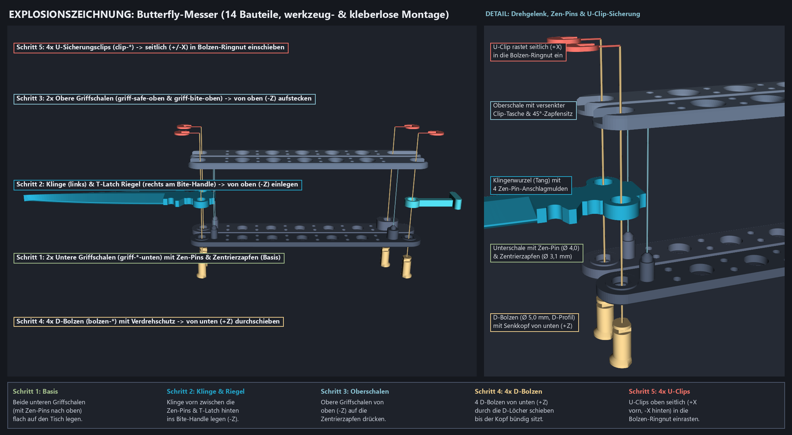

# Butterfly-Messer (`butterfly-messer`): Maße, Gelenke & Kinematik-Verifikation

## 1. Maß- und Spezifikationstabelle (`research-part-specs`)

Referenzbild: [`model-sources/archiv/butterfly-messer-referenzfotos-index.png`](../model-sources/archiv/butterfly-messer-referenzfotos-index.png) (Kachel `00`: klassisches skelettiertes Edelstahl-Butterfly-Messer im geschlossenen und geöffneten Zustand mit T-Latch).

| Merkmal / Parameter | Wert | Herkunft & Quelle | Vertrauen (`Confidence`) |
| --- | ---: | --- | --- |
| Gesamtlänge geöffnet (inkl. T-Latch) | `243.45 mm` (`220.0 mm` ohne Latch) | Standard-Balisong-Geometrie (Benchmade 42: `9.4 in / 238.8 mm` geöffnet) + Proportionen aus Kachel `00` | Hoch (publiziertes Standardmaß + Fotoabgleich) |
| Grifflänge (`U = -6.0 .. +119.0 mm`) | `125.00 mm` | Klassisches 5-Zoll-Balisong-Heft (`4.92–5.00 in / 125 mm`), Kachel `00` | Hoch (publiziertes Standardmaß) |
| Freie Klingenlänge ab Drehpunkt (`X = -95.0 .. 0.0 mm`) | `95.00 mm` | Abgestimmt auf `125 mm` Grifflänge, sodass die Klingenspitze bei `180°` mit `> 10 mm` Sicherheitsabstand vor dem hinteren Distanzblock im Griffkanal liegt | Hoch (kinematisch verifiziert) |
| Klingenbreite / Klingenhöhe (`Y`) | `16.80 mm` | Proportion aus Kachel `00` (Spear-/Clip-Point mit ausgeprägter Fehlschärfe/Swedge und Choil) | Mittel–Hoch (Foto-kalibriert) |
| Klingendicke am Rücken (`Z`) | `3.60 mm` | FDM-optimierte Blattstärke für verwindungssteife PLA-Spachtelklinge im `4.20 mm` hohen Griffkanal | Hoch (Benutzer-Interview & FDM-Auslegung) |
| Spachtel-/Kratzer-Schneide (`R_EDGE_BLUNT` / Fase) | `0.40 mm` Vorderkante, `45°` beidseitig (`1.60 mm` tief) | Vom Benutzer im Interview gewünschte mechanisch nutzbare Schaber-/Spachtelkante; stützfrei liegend druckbar | Bestätigt (Benutzer-Entscheidung) |
| Griffkanal-Innenhöhe (`Z_CHANNEL_MIN .. MAX`) | `3.20 .. 7.40 mm` (`4.20 mm` lichte Weite) | `3.60 mm` Klinge + `2 × 0.30 mm` Axialspiel (`0.30 mm` unten, `0.30 mm` oben) | Bestätigt (Benutzer-Interview: `0.30 mm` Gelenkspiel) |
| Griffschalen-Wandstärke unten / oben | `3.20 mm` (`Z = 0..3.2` und `8.4..11.6 mm`) | Robuste Sandwich-Schalen für `1.6 mm` Wandstärke (4 Wandlinien) und `55%` Gyroid-Füllung | Bestätigt (Benutzer-Interview) |
| Drehpunkt-Abstand (`±Y_PIVOT`) | `±10.20 mm` (`20.40 mm` Stichmaß) | Symmetrischer Abstand der beiden Griff-Hauptachsen; ergibt `0.50 mm` Spalt zwischen Safe- und Bite-Handle bei `0°` und `180°` | Hoch (kinematisch verifiziert) |
| Integrierter Zen-Pin-Anschlag (`X_ZEN`, `±Y_ZEN`, `R_ZEN`) | `X = 0.00 mm`, `Y = ±10.20 mm` (lokal `u = 10.20 mm`), `Ø 5.20 mm` | In die unteren Griffschalen integrierter Anschlagpfosten; greift bei `0°` (geöffnet) und `180°` (geschlossen) exakt in die vier halbrunden Tang-Mulden (`R = 2.85 mm`) der Klingenwurzel | Hoch (analytisch & mit Manifold-Sweeps bewiesen) |
| Skelett-Lochbild der Griffe | 5 große Senkbohrungen (`Ø 6.80 mm`) + 6 Paare kleiner Bohrungen (`Ø 2.50 mm`) | Exakt nach Kachel `00` (5 große Mittellöcher im Wechsel mit 6 paarweisen Niet-/Stiftlöchern entlang beider Griffhälften) | Hoch (direkter Nachweis in Kachel `00`) |
| Drehgelenk-Spiel radial (`PIVOT_CLEARANCE_RAD`) | `0.30 mm` (`Ø 5.30 mm` Bohrung auf `Ø 4.70 mm` Bolzenschaft) | Vom Benutzer gewähltes leichtgängiges PLA-Drehgelenk-Spiel | Bestätigt (Benutzer-Interview) |
| Rast- & Steck-Spiel (`CLIP_CLEARANCE`) | `0.15 mm` | Vom Benutzer gewähltes Spiel für U-Clips und D-Bolzen-Sitz | Bestätigt (Benutzer-Interview) |

---

## 2. Werkzeuglose, lösbare FDM-Verbindungen (`reversible-fdm-joints`)

Um das Messer komplett **ohne Klebstoff**, **ohne Metallschrauben** und mit **0,00 g Stützstruktur** zu drucken und dennoch jederzeit zerlegen/warten zu können, wurden folgende formschlüssige Verbindungen konstruiert:

1. **4× Verdrehgesicherte D-Bolzen (`butterfly-messer-bolzen-*`):**
   - Schaft-Nenndurchmesser `Ø 4.70 mm` (`R = 2.35 mm`) mit durchgehender Abflachung bei `y_local = -2.00 mm` (D-Profil).
   - Dadurch liegt der Bolzen beim Drucken auf Platte 3 komplett flach auf seiner D-Abflachung (`Z_print = 0.00 mm`) — die Schichten verlaufen **längs zur Bolzenachse**, was maximale Scher- und Biegefestigkeit quer zum Gelenk garantiert!
   - Der Übergang vom Senkkopf (`R = 3.60 mm`) zum Schaft erfolgt über eine selbsttragende **45°-Fase**, passend zur 45°-Senkung in den unteren Griffschalen.
2. **4× Formschlüssige U-Sicherungsclips (`butterfly-messer-clip-*`):**
   - Greifen seitlich (`±X`) in eine 3-seitige Ringnut (`x_local = ±1.45 mm`, `y_local = +1.45 mm`, `Z = 9.45 .. 10.75 mm`) am oberen Bolzenende ein und liegen versenkt in den Taschen der oberen Griffschalen (`Z = 9.45 .. 10.65 mm`).
3. **Integrierte Passzapfen zwischen Unter- und Oberschale:**
   - Jede untere Griffschale (`griff-*-unten`) besitzt am Zen-Pin (`u = 10.20 mm`) und im hinteren Distanzblock (`u = 99.00 mm`) je einen Zentrierzapfen (`Ø 3.10 mm`, `Z = 8.40 .. 9.65 mm`), der in eine passende Senktasche (`Ø 3.40 mm` mit selbsttragendem **45°-Kegeldach**) der oberen Griffschale (`griff-*-oben`) eingreift.
4. **Schwenkbarer T-Latch (`butterfly-messer-riegel`):**
   - Sitzt auf dem hinteren D-Bolzen des Bite-Handles (`u = 108.50 mm`, `y = -10.20 mm`) und verriegelt im geschlossenen Zustand (`180°`) bei `phi_latch = 90°` formschlüssig in der Riegelmulde am Ende des Safe-Handles.

---

## 3. Montage-Reihenfolge & Lineare Einschub-Sweeps (0,000 mm³ Kollision)

Alle 12 beweglichen bzw. einzusetzenden Bauteile wurden in [`scripts/butterfly_messer.py`](../scripts/butterfly_messer.py) über je **21 Schritte** (`0.0 mm .. 28.0 mm`) entlang ihres Montagevektors gegen alle bereits montierten Bauteile auf Manifold-Schnittvolumen geprüft:

| Schritt | Bauteil | Einschub-Richtung | Geprüfte Hindernisse (bereits montiert) | Max. Schnittvolumen (`mm³`) | Status |
| ---: | --- | :---: | --- | ---: | :---: |
| 1 | `griff-safe-unten` & `griff-bite-unten` | Basis auf Tisch | — | `0.000000` | **PASS** |
| 2 | `butterfly-messer-klinge` | `-Z` `(0, 0, -1)` | `griff-safe-unten`, `griff-bite-unten` | `0.000000` | **PASS** |
| 3 | `butterfly-messer-riegel` | `-Z` `(0, 0, -1)` | `griff-safe-unten`, `griff-bite-unten`, `klinge` | `0.000000` | **PASS** |
| 4 | `griff-safe-oben` | `-Z` `(0, 0, -1)` | `griff-safe-unten`, `klinge`, `riegel` | `0.000000` | **PASS** |
| 5 | `griff-bite-oben` | `-Z` `(0, 0, -1)` | `griff-bite-unten`, `klinge`, `riegel` | `0.000000` | **PASS** |
| 6 | `bolzen-safe-vorn` | `+Z` `(0, 0, +1)` | `griff-safe-unten`, `griff-safe-oben`, `klinge` | `0.000000` | **PASS** |
| 7 | `bolzen-bite-vorn` | `+Z` `(0, 0, +1)` | `griff-bite-unten`, `griff-bite-oben`, `klinge` | `0.000000` | **PASS** |
| 8 | `bolzen-safe-hinten` | `+Z` `(0, 0, +1)` | `griff-safe-unten`, `griff-safe-oben` | `0.000000` | **PASS** |
| 9 | `bolzen-bite-hinten` | `+Z` `(0, 0, +1)` | `griff-bite-unten`, `griff-bite-oben`, `riegel` | `0.000000` | **PASS** |
| 10 | `clip-safe-vorn` & `clip-bite-vorn` | `+X` `(+1, 0, 0)` | Zugehörige Griffschalen + D-Bolzen | `0.000000` | **PASS** |
| 11 | `clip-safe-hinten` & `clip-bite-hinten` | `-X` `(-1, 0, 0)` | Zugehörige Griffschalen + D-Bolzen | `0.000000` | **PASS** |

---

## 4. Kinematische Verifikation über den gesamten Schwenkbereich (`0° .. 180°`)

- **Griff-Rotation (`theta_safe`, `theta_bite` von `0°` bis `180°` in `5°`-Schritten = 37 Zustände):**
  - Safe-Handle rotiert um `(0.0, +10.20 mm)` über `+Y` von `0°` (geöffnet) bis `+180°` (geschlossen).
  - Bite-Handle rotiert um `(0.0, -10.20 mm)` über `-Y` von `0°` (geöffnet) bis `-180°` (geschlossen).
  - **Ergebnis:** Über alle 37 Winkelstellungen beträgt das paarweise Manifold-Schnittvolumen zwischen Klinge, Safe-Handle-Baugruppe, Bite-Handle-Baugruppe und T-Latch exakt **`0.000000 mm³`** (`PASS`).
- **T-Latch-Schwenkbereich im geschlossenen Zustand (`theta = 180°`, `phi_latch` von `0°` bis `90°` in `5°`-Schritten = 19 Zustände):**
  - Der T-Latch schwenkt frei um den hinteren Bite-Bolzen `(-108.50 mm, -10.20 mm)` von der offenen Längsstellung (`0°`) bis in die verriegelte Querstellung (`90°`) über dem Safe-Handle.
  - **Ergebnis:** Maximales Schnittvolumen über alle 19 Riegel-Winkelstellungen: **`0.000000 mm³`** (`PASS`).
- **Endlagen-Nachweis:**
  - **Geöffnet (`0°`):** Die Zen-Pins liegen mit definiertem Spiel in den vorderen Tang-Mulden; die beiden Griffe haben `0.50 mm` parallelen Abstand; die Klinge steht frei über `95.0 mm` vor.
  - **Geschlossen & verriegelt (`180°`, `phi_latch = 90°`):** Die Spachtel-Schneide liegt vollständig geschützt innerhalb des Bite-Handle-Kanals; die Zen-Pins stützen sich in den hinteren Tang-Mulden ab; der T-Latch umschließt das hintere Ende des Safe-Handles formschlüssig.
