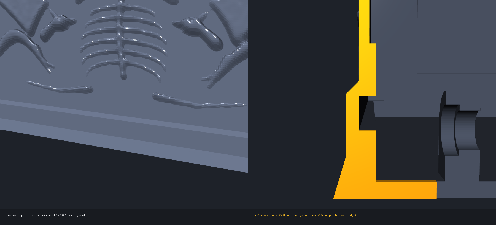

# The Ghoul's Grip – OrcaSlicer-Druckvalidierung

Slice-Ergebnis: **verifiziert** mit OrcaSlicer CLI; Profilkonformität: **verifiziert** (`layer_height = 0.16`, `seam_position = random`, `ironing_type = top`, `support_type = tree(auto)` mit `0.16 mm` Z-Kontaktabstand).

**Stand 2026-10-19 (Rückwand-/Sockel-Verbindung + 0,16-mm-/Random-Seam-/Tree-Support-Pflichtregeln):**
Bei der gedruckten Schatulle zeigte sich an der Rückwand im Übergang zum Sockel (`Z = 8,0 .. 12,0 mm`) ein horizontaler Trennspalt: Die innere Schlitten-Führungsnut (`|y| = 54,0 .. 60,0 mm`, `Z = 8,0 .. 12,0 mm`) schnitt die nominelle `2,0-mm`-Kistenwand (`|y| = 58,0 .. 60,0 mm`) auf ganzer Höhe durch, während die äußere Schienenabdeckung (`rail_covers`) nur `|y| = 60,0 .. 61,2 mm` über `Z = 8,0 .. 12,0 mm` abdeckte – bei `Z = 12,0 mm` bestand dadurch `0,00 mm` horizontale Überlappung (reiner Linienkontakt) und bei `Z = 8,46 mm` nur `0,46 mm` Restwandstärke.
In `scripts/gothic_chest.py` wurde `rail_covers` als durchgehende 5-Punkt-Rippe (`Z = 5,0 .. 13,7 mm`, `|y| = 58,0 .. 61,5 mm` mit 45°-Fase bis `|y| = 60,0 mm` bei `Z = 13,7 mm`) neu aufgebaut. Dadurch beträgt die Außenwandstärke entlang der Führungsnut durchgängig `1,50 mm` und bildet bei `Z = 12,0 .. 12,2 mm` eine `3,50 mm` starke horizontale Brücke zwischen Sockel und Kistenwand.
Als Grundlage für `models/ghouls-grip-print.3mf` wurde die vom Nutzer bereitgestellte `ghouls-grip-print.3mf` übernommen und mit allen verbindlichen 3MF-Regeln (`layer_height = 0.16` `<= 0.16 mm`, `seam_position = random`, `support_type = tree(auto)`, `support_top_z_distance = 0.16`, `support_bottom_z_distance = 0.16`) aktualisiert.

Aktuelle finale SHA-256 (2026-10-19):

| Datei | SHA-256 |
| --- | --- |
| `models/ghouls-grip-view.3mf` | `B5EB5A2A932FF3187CAA2222E3069684823766B4A9940110418743D48664BCEF` |
| `models/ghouls-grip-preview.stl` | `ED4E52DB79CF4520BB1988945747714AC6141CCD633E5A2457C7B09086AE8CFC` |
| `models/ghouls-grip-print.3mf` | `001C05B7D6FD96E0D24DAB3D967AC6844E5FF7A62835A74B125FC134678E6D8C` |

Schatulle: 76.668 Facetten, 209 × 130,5 × 98 mm, 202.470,353 mm³,
ein geschlossener Einzelkörper, konsistente Normalen, keine degenerierten
Dreiecke. Das komplette ASCII-STL ist bewusst eine montierte
41-Körper-Vorschau, kein Drucklayout; 41 Druckobjekte inklusive Reservepins
sind im vierplattigen Print-Projekt.

Historie (2026-10-12, 37-Objekt-Stand): Die damalige Bodenlagerreparatur
ersetzte ausschließlich die Schatullen-Geometrie;
die übrigen **36 Mesh-Payloads bleiben byteidentisch** zur übernommenen
Nutzerdatei (`HEAD`). Alle 37 Mesh-Payloads, Objekt-Overrides, Farben,
Materialien und `project_settings.config` bleiben erhalten. Die 16
Getriebe-/Verbinderteile liegen jetzt gemeinsam mit den 11 Hauptteilen auf
Platte 3; alle 37 Objekte bleiben genau einmal in der vollständigen Stückliste.
Die exakte finale Druckdatei wurde unabhängig geladen: 37 geschlossene,
orientierungskonsistente Einzelkörper, null degenerierte Dreiecke, alle innerhalb
ihres 250-mm-Betts, Z-Bettkontakt mit 0,01-mm-Rundtoleranz; größtes Bauteil-/Bauteil-Schnittvolumen
auf einer Druckplatte 0,000 mm³. Auch die Arm-/Bodenlagerpaare der montierten
Mechanik bestehen jetzt den 61-Zustands-Nachweis; das ist keine Lastfreigabe.
Prüfartefakt: `build/ghoul-floor-bearing-delivery.json`.

## Sichtbare Stützstrukturen

**Orange zeigt tatsächlich extrudierte Support- und Support-Interface-Bahnen**
aus den vier frischen G-Codes; transparentes Grau zeigt die zugehörigen
Bauteile. Es ist ein G-Code-Bahnrender, kein OrcaSlicer-UI-Screenshot.

Einzelansichten: [Platte 1 – Schwarz](images/ghouls-grip-print-plate-1-supports.png),
[Platte 2 – Knochenbeige](images/ghouls-grip-print-plate-2-supports.png),
[Platte 3 – Naturweiß, 31 Teile](images/ghouls-grip-print-plate-3-supports.png),
[Platte 4 – Grau](images/ghouls-grip-print-plate-4-supports.png).

Die Screenshots basieren exakt auf der aktuellen Druckdatei und den am
2026-10-17 neu erzeugten vier G-Codes in `build/ghoul-final-slices/print/`.
Reproduktion:
`.\.venv\Scripts\python.exe scripts\render_ghouls_grip_print_projects.py build\ghoul-final-slices\print --project models\ghouls-grip-print.3mf`
und
`.\.venv\Scripts\python.exe scripts\render_ghouls_grip_supports.py build\ghoul-final-slices\print --project models\ghouls-grip-print.3mf`.
Die Supportpfade bleiben eine separate Bildvorschau und werden nicht in die
3D-Modellgeometrie eingeblendet. Canvas und Web-UI bieten jetzt zusätzlich
direkte Buttons für die einzelnen Plattenbilder; ein Klick öffnet das Bild groß.
## Profilvertrag und tatsächliche Nutzereinstellungen

Das Druckprojekt wurde vom Nutzer in OrcaSlicer geändert. Die aktuellen
Einstellungen werden hier dokumentiert und nicht stillschweigend auf frühere
Vorgaben zurückgesetzt:

- Drucker: `Anycubic Kobra S1 0.4 nozzle`; Düse/Schichthöhe: 0,4 mm / 0,20 mm
- Ein separat benannter Prozessprofilname ist in der 3MF nicht gespeichert;
  die Prozesswerte sind in `Metadata/project_settings.config` eingebettet.
- Filamentprofil: `Anycubic PLA @Anycubic Kobra S1 0.4 nozzle` für vier PLA-Slots
- Im gespeicherten Projekt: Bett `High Temp Plate`, Naht `aligned`, Bügeln
  `no ironing`, global `enable_support=0`, globale Basiswerte 2 Wandlinien und
  15 % Infill.
- Bauteil-Overrides aktivieren Support (`enable_support=1`) für die betreffenden
  Objekte; alle vier frischen G-Codes enthalten echte Supportbahnen. Platte 3
  enthält jetzt sämtliche Naturweißteile einschließlich der früheren
  Transferzahnräder.
- Support nur auf Druckplatte, globaler Typ `tree(auto)`; Objekt-Overrides
  verwenden teils `normal(auto)`.

Diese Datei weicht damit vom Projektstandard `Textured PEI Plate`, `seam=random`,
`ironing=top` und global aktiviertem Support ab. Der Slice war erfolgreich, aber
Profilkonformität und Druckbereitschaft sind **nicht verifiziert**. OrcaSlicer
meldete für alle vier Plates, dass `precise wall` bei den gewählten
Wandsequenzen ignoriert wird; die G-Code-Erzeugung war erfolgreich. Es wurde
keine automatische Wiederherstellung oder Neuanordnung der Teile zugelassen.

## Bodenlagerkorrektur, Reproduktion und Freigabegrenze

Die zentralen kollidierenden Bodenpfosten sind als kurze Doppelwangen um
die unveränderten Armhüllen neu aufgebaut. Der 12-mm-Kanal gibt 1 mm
Axialabstand; die 4-mm-Wangen haben 3 mm radiale Bohrungsstege und direkt
angebundene 9,2 × 4 mm Bodenwurzeln. Alle neuen Maße sind
Konstruktionsschätzungen/Default-Freiräume und brauchen einen PLA-Passungs-
und Lasttest, keine neu behaupteten Messwerte.
Die bestehenden 26-mm-Pins werden von der Kistenmitte eingeführt;
der Kopf des positiven Bodenpins ist im Ansichtsprojekt entsprechend
gespiegelt. Der Print-Pin und die komplette Stückliste bleiben unverändert.

Der ursprüngliche Wandcutter (14 × 12 × 24 mm bei X=-27, Y=58, Z=75)
ist entfernt. Der Folgejoch-Rack liegt 14,854 mm weiter innen; zwei gleiche
Transferzahnräder erhalten 1:1-Übersetzung, 7-mm-Hub und 108° Deckelbewegung.
Die neue Journalhalterung und die asymmetrische Haube schneiden weder Wand
noch mittleren Scharnierbock. Die Dach-/Wandproben zeigen durchgängiges Material.

Beim Print-Refresh verursachte reine Bounds-Zentrierung der höheren neuen Kurbel
einen Boden unter Z=0; OrcaSlicer 2.4.2 brach dabei mit Access Violation ab.
Der Export erhält jetzt die originale transformierte Bettkontakt-Ebene.
Historischer Befund der Wandkorrektur: Die 31 damals unbetroffenen Payloads
wurden nicht neu gerundet. Sowohl fünf einzelne
Platten-Slices als auch der abschließende `--slice=0`-Kontrolllauf waren danach
erfolgreich. Der **aktuelle finale** Kontrolllauf am 2026-10-12 mit
`scripts/slice_ghouls_grip.ps1` hat nach der Plattenzusammenlegung Exit-Code 0
und vier echte G-Codes. Die Kopfzeile jedes frischen G-Codes
bestätigt OrcaSlicer 2.4.2. Die tatsächliche Installation wurde unter
`C:\Program Files\OrcaSlicer\orca-slicer.exe` gefunden;
`--help` endete mit Exit 0 ohne Konsolentext, daher wurden die bereits
funktionierenden Optionen des vorhandenen Slice-Skripts verwendet.
Die externen Mesh-Relationships sind ohne XML-Namenspräfix serialisiert, wie
Orcas Importer es erwartet.

| Befehl / Nachweis | Ergebnis |
| --- | --- |
| `.\.venv\Scripts\python.exe -m unittest discover -s tests` | PASS: 63 Tests (Stand 2026-10-17) |
| `.\.venv\Scripts\python.exe -m unittest discover -s tests -p test_ghouls_grip_print_refresh.py -v` | nach finaler Bettkontakt-Korrektur erneut bestanden; Originaltransforms, Overrides, Plate-Zuordnung, unveränderte Payloads und Idempotenz |
| `.\.venv\Scripts\python.exe -m unittest discover -s tests -p test_slice_support_usage.py -v` | 3 Tests bestanden; M82/M83/G92 und Rückstellungen |
| `.\.venv\Scripts\python.exe scripts\verify_ghouls_grip_mechanics.py` | Gesamt-Nachweis PASS; 61 Scherenstellungen von 18° bis 78° inkl. 48°, alle vier individuellen Arm-/Kistenpaare jetzt hartes Fail-Gate bei >0,001 mm³; übrige geprüfte Paare 0 mm³; JSON in `build/ghoul-floor-bearing-verification.json` |
| `python scripts\consolidate_ghouls_grip_mechanism_plates.py` | PASS: alle 31 Naturweißteile auf einer Platte; mindestens 10 mm Bettrand, 6 mm Rahmenabstand, Teileorientierungen und Mesh-Payloads erhalten |
| `python scripts\arrange_ghouls_grip_bone_plate.py` | PASS: sieben Teile auf Platte 2 mit mindestens 6 mm Footprint-Abstand und mindestens 69 mm Bettrandabstand; nur XY-Translationen geändert |
| `powershell -NoProfile -ExecutionPolicy Bypass -File scripts\slice_ghouls_grip.ps1` | Exit 0 und vier frische OrcaSlicer-2.4.2-G-Codes |
| `python scripts\update_ghouls_grip_slice_metadata.py build\ghoul-final-slices\print --project models\ghouls-grip-print.3mf` | neue Slice-Kennzahlen gespeichert; Profilstatus weiter `not-verified` |
| `python scripts\render_3mf_previews.py models\ghouls-grip-print.3mf` | vollständige Projektvorschau aus dem exakten 3MF regeneriert |
| `python scripts\render_ghouls_grip_print_projects.py build\ghoul-final-slices\print --project models\ghouls-grip-print.3mf` und `python scripts\render_ghouls_grip_supports.py build\ghoul-final-slices\print --project models\ghouls-grip-print.3mf` | vier Plattenvorschauen und vier tatsächliche G-Code-Support-Sidecars |
| `.\.venv\Scripts\python.exe scripts\mesh_tool.py validate models\ghouls-grip-preview.stl --allow-multibody` | PASS: 270.134 Facetten, 41 absichtlich getrennte montierte Körper, geschlossen/orientiert, null degenerierte Dreiecke; Zentrierwarnung der nicht druckbaren Assembly-Vorschau, nicht verschoben |

**Die dokumentierte Arm-/Bodenlagerkollision ist beseitigt:** Baseline
496,131 / 519,274 / 554,635 mm³ bei 18° / 48° / 78°; aktuell
0,000 mm³ bei drei Nachkommastellen in allen 61 Zuständen.
Maximaler numerischer Rest je Einzelarm: 0,000020464 mm³ an der
tangentialen Bodenberührung, unter 0,001 mm³ Boolean-Toleranz.
Das ist ausdrücklich kein mathematisch exakt nuller Floating-Point-Wert.
Alle anderen im Vollnachweis geprüften Paare sind 0 mm³ und die
Wandfüllung bleibt 100 %. Einzelpaarvolumina stehen in der
[Mechanik-Verifikation](ghouls-grip-mechanik-verifikation.md).
Weiterhin keine physische Druck-/Lastfreigabe: PLA-Passung,
Supportentfernung aus kleinen Querbohrungen, Axialwanderung der bisherigen
unverriegelten Bodenpins, Journalspiel, Zahnprofile, Bodeneinleitung und
Dauerfestigkeit müssen getestet werden. Der Slice enthält echte Supports,
deren Entfernbarkeit im kleinen Lagerbereich noch physisch zu prüfen ist.

## Ergebnisse des aktuellen Slices

| Plate | Inhalt | Schichten | Filament | davon Stützen | Zeit | Ansicht |
| --- | --- | ---: | ---: | ---: | ---: | --- |
| 1 – Black PLA+ (Schatulle, Slot 3) | Schatulle und Deckel (2) | 816 | 334,01 g | 5,99 g (1,8 %) | 13 h 15 min 18 s | [Supportbild](images/ghouls-grip-print-plate-1-supports.png) |
| 2 – PLA Slot 2 (Knochen) | Unterarm, Handfläche und Finger (7) | 633 | 44,48 g | 6,10 g (13,7 %) | 3 h 41 min 22 s | [Supportbild](images/ghouls-grip-print-plate-2-supports.png) |
| 3 – PLA Slot 1 (Mechanik) | Hauptmechanik, Zahnräder, Wellen, Pins und Kurbel-Distanzhülse (31) | 519 | 116,95 g | 15,33 g (13,1 %) | 6 h 53 min 05 s | [Supportbild](images/ghouls-grip-print-plate-3-supports.png) |
| 4 – PLA Slot 4 (Totenkopf-Auslöser) | Totenkopf-Auslöser (1) | 168 | 24,30 g | 3,18 g (13,1 %) | 1 h 14 min 26 s | [Supportbild](images/ghouls-grip-print-plate-4-supports.png) |
| **Gesamt** | **41 Druckobjekte / 4 Plates** | – | **519,74 g** | **30,60 g (5,9 %)** | **25 h 04 min 11 s** | [Übersicht](images/ghouls-grip-print-support-overview.png) |

| Farbgruppe | Zeit | Masse | Stützmaterial | Länge | Volumen | Plates |
| --- | ---: | ---: | ---: | ---: | ---: | ---: |
| Black PLA+ (Schatulle, `#212721`) | 47.718 s | 334,01 g | 5,99 g | 111.987,71 mm | 269.360 mm³ | 1 |
| PLA Slot 2 (Knochen, `#89A84F`) | 13.282 s | 44,48 g | 6,10 g | 14.913,92 mm | 35.870 mm³ | 1 |
| PLA Slot 1 (Mechanik, `#FFC196`) | 24.785 s | 116,95 g | 15,33 g | 39.210,73 mm | 94.310 mm³ | 1 |
| PLA Slot 4 (Totenkopf-Auslöser, `#009CBD`) | 4.466 s | 24,30 g | 3,18 g | 8.148,82 mm | 19.600 mm³ | 1 |
| **Gesamt** | **90.251 s** | **519,74 g** | **30,60 g** | **174.261,18 mm** | **419.140 mm³** | **4** |

Die Supportanteile werden aus positiven Extrusionen der Support-/Interface-
Bewegungen berechnet; `M82`, `M83` und `G92` werden berücksichtigt,
Extruder-only-Rückstellungen nicht als gedruckter Support gezählt.
Die vorherige absolute-E-Auswertung der relativen Orca-Extrusion war falsch.
Masse und Volumen werden mit dem jeweiligen Slice-Verhältnis umgerechnet:

| Plate | Supportlänge | Supportvolumen |
| --- | ---: | ---: |
| 1 | 2.007,88 mm | 4.829 mm³ |
| 2 | 2.046,68 mm | 4.923 mm³ |
| 3 | 5.140,02 mm | 12.363 mm³ |
| 4 | 1.066,12 mm | 2.564 mm³ |
| **Gesamt** | **10.260,70 mm** | **24.679 mm³** |

Die Summen und vier Einzelergebnisse sind in `models/ghouls-grip-print.3mf`
als slicer-neutrale Metadaten gespeichert. Der Metadatenstatus bleibt
`not-verified`, bis Profilabweichungen und CLI-Diagnose geprüft sind.
G-Code-, Mesh- und Modellhashes sowie ausgeführte Befehle stehen zusammen
in `build/ghoul-floor-bearing-quality.json`; Vollsweep und Print-Prüfung in
`build/ghoul-floor-bearing-verification.json` und
`build/ghoul-floor-bearing-delivery.json`.
### Historische Orientierungsoptimierung (A/B-gemessen, nicht aktueller Slice)

Alle Druckorientierungen sind durch echte A/B-Slices belegt. Die Audit-Skripte
klonen dieselbe Projektvorlage und tauschen nur das Build-Item aus, sodass
ausschließlich die Orientierung variiert:

| Teil | Orientierung | Stütz-Extrusion | Alternativen |
| --- | --- | ---: | --- |
| Deckel | auf der Hinterkante stehend | **4.598,9 E** | aufrecht 20.336,1 · kopfüber 20.553,3 · Vorderkante 14.840,6 |
| Handfläche | auf dem Handgelenkschnitt stehend | **290,0 E** | wie gebaut 2.958,9 · gespiegelt 1.970,5 · seitlich 2.084,5–3.102,7 |
| Totenkopfknopf | Gesicht nach oben auf dem Wellenbund | **968,7 E** | wie gebaut 3.266,5 · seitlich 655,8–793,9 (verworfen: Stützen im Gesicht) |
| Unterarm | wie gebaut | **0,0 E** | alle gekippten Varianten 318,2–414,1 |

Skripte: `scripts/audit_lid_orientation.py`, `scripts/audit_part_orientation.py`,
`scripts/audit_chest_support.py`.

Historischer Vergleich vor dieser Wandkorrektur: Gegenüber dem damals
verifizierten Stand (528,22 g / 138,60 g Support) sank der
Stützbedarf um **83,21 g / 60,0 %** und die Gesamtmasse um 11,38 g. Die
gemessenen Orientierungswechsel tragen den Hauptteil der Einsparung; die
zusätzliche geschlossene Deckelhaube erhöht das schwarze Projekt nur um 1,59 g.
Gegenüber dem ursprünglichen 629,66-g-Entwurf beträgt die Materialeinsparung
**112,82 g / 17,9 %**, gegenüber der Vor-Leichtbau-Schatulle (455,96 g schwarz)
**125,00 g / 27,4 %**.

Der Nutzerstand vor der Wandkorrektur lag bei 77.721 s, 527,20 g Filament und
28,42 g Support. Die aktuelle Änderung erhöht das um 279 s, 1,76 g Filament
und 1,36 g Support. Diese Differenz stammt aus echten Slices; die historischen
Werte ersetzen nicht die oben aufgeführten neuen Ergebnisse.

## Stützen und Objekt-Overrides

- Schatulle/Deckel: 3 Wände, 10 % Gyroid, Baumstützen `tree(auto)` bettgebunden;
  analytischer maximaler Deckel-Brückenspalt 10,0 mm, Schatulle 6,0 mm.
- Mechanik: 5–6 Wände, modellierte Öffnungen, Rahmen, Rippen und Speichen;
  20–50 % Infill in den verbleibenden Hohlräumen. Arme und Pins bleiben durch
  Wandlinien praktisch massiv.
- Hand/Knochen: 4 Wände, 25 %; die Handfläche steht auf dem Handgelenkschnitt,
  wodurch Fingertaschen und Daumenballen senkrecht statt überhängend drucken.
- Finger: 2 Wände, 15 %, 30 mm/s Außenwand und reduzierte Beschleunigung für die 0,8-mm-PLA-Flexuren.
- Totenkopfknopf: 5 Wände, 40 %, Gesicht nach oben, damit keine Stützstruktur
  die skulptierte Fläche berührt.

## Beibehaltene Support-/Materialoptimierung und Wandkorrektur

- Der Deckel besitzt eine 2,4-mm-Deckhaut, offene Unterseiten-Träger,
  fünf gerippte Längstraversen und fünf kurze hintere Anschlagpads statt eines
  massiven, 193 mm breiten Querriegels. Er steht auf seiner Hinterkante: in
  dieser Lage ist weder die hohle Innendecke noch das skulptierte Kartuschen-
  relief ein großer Überhang (4.598,9 statt 20.336,1 Stütz-E).
- Der frühere durchgehende Servicekanal für Yoke und Deckelkurbel ist nach außen
  vollständig geschlossen. Eine lokale schwarze Haube besitzt eine 2,0-mm-
  Dachhaut, eine ausschließlich nach innen offene Montagekavität und eine
  gemessene Labyrinth-Freistellung am Scharnier. Im geschlossenen Zustand liegt
  jedes interne Mechanikteil unter dieser Deckelgeometrie; der vollständige
  18°–78°-Sweep ergibt für `lid_crank_lid`, `lid_yoke_lid`, `lid_chest` und
  die jeweiligen Brustkontakte jeweils **0,000 mm³**.
- In der aktuellen Nutzerdatei teilen sich Schatulle und stehender Deckel
  dieselbe schwarze Platte; beide passen nebeneinander innerhalb des 250-mm-Betts.
  Die vorherige Sechs-Platten-Aufteilung hatte dafür zwei separate Schwarz-Platten.
- Der Sockel und der obere Kranz der Schatulle wurden von horizontalen Stufen
  auf zwei geneigte, selbsttragende Kurse umgebaut. Die Pilasterkapitelle und
  die Unterseiten der Scharnierlager sind ebenfalls geneigt.
- Die dekorative Schatullenwand und der Boden sind 2,0 mm stark; die
  3,0-mm-Funktionsdatums an Schienen, Lagern und Führungen bleiben erhalten.
  Gerundete Außenkanten sowie vertiefte statt aufgesetzte Reliefs wirken
  organischer und vermeiden zusätzliche massive Zierkörper.
- Historischer Leichtbauschritt: Das Schatullen-Volumen sank von 295.062 auf 184.056 mm³
  (**−37,6 %**), das Deckelvolumen von 252.068 auf 124.903 mm³
  (**−50,5 %**). Zusammen sind das **−43,5 % Modellvolumen**.
- Acht überarbeitete Mechanikteile sanken durch offene Rahmen, Fenster und
  Speichen von 118.567 auf 82.649 mm³ (**−30,3 %**).
- Der Deckel bleibt ein einzelner watertight/manifold Körper:
  27.868 Facetten, 206 × 129,786 × 28,2 mm. Die aktuelle Schatulle hat
  199.297,757 mm³, der Deckel 134.466,876 mm³. Die lokale Schutzhaube ist nur
  2,6 mm höher als das skulptierte Kartuschenrelief und enthält keine
  getrennten oder eingeschlossenen Körper.
- Die Schienen- und Lagerbooleans werden zuerst in der bewährten Kernschale
  erzeugt; die geneigten Zierkurse werden danach kontrolliert angefügt. Dadurch
  bleiben die mechanischen Führungen geschlossen und manifold.
- Die aktualisierten farbigen Plattenvorschauen wurden aus den neuen 3MF-Szenen
  regeneriert. Sie zeigen die Material-/Farbgruppierung, nicht geslicte
  Supportvolumina.

## Anzeige in Canvas und Web-Viewer

Die ausgelieferten 3MF-Dateien enthalten die verifizierten Projektwerte direkt
in `Metadata/ghouls_grip_print_metadata.xml`. Der gemeinsame Web-/Canvas-
Renderer zeigt daraus:

- eine kompakte Zeile mit Druckzeit, Gesamtmaterial, Supportmaterial,
  Filamentlänge und Validierungsstatus für **alle Plates**, unabhängig von
  der ausgewählten Ansicht;
- ein einklappbares Detail-Overlay rechts unten mit Maschine, Düse, Prozess,
  Filamentprofil, Material, Farbe, Bett, Wandzahl, Infill, Support und
  Plattenzahl;
- im Detail-Overlay eine separat aufklappbare Tabelle **Print data by plate**
  mit Druckzeit, Material, Supportmaterial, Filamentlänge, Supportlänge, Status und einem
  Supportbild-Button pro gesliceter Plate. Die Bilder zeigen die tatsächlich
  extrudierten Supportbahnen und sind in Canvas sowie Webview per Dialog
  anzusehen. Fehlende oder fehlerhafte Plate-Metadaten werden ausdrücklich angezeigt;
- ein Projektvorschau-Button für das vollständige farbcodierte
  Vier-Platten-Druckprojekt;
- die korrekte einzelne Platte oder alle Platten unter Berücksichtigung von
  3MF-Komponenten-Transformationen und OrcaSlicer-`plater_id`;
- ein einklappbares Werkzeugmenü für Reload, Auto-Reload, Zoom, Wireframe,
  Shading, Ansichten, Rotation, Hilfsanzeigen und Messung.

Mehrplattige Dateien starten in Canvas und Web-Viewer mit **All plates**.
Mehr als zwei Platten stehen nur in der Gesamtansicht in einem Grid mit
50 mm Zwischenraum; zwei Platten stehen nebeneinander. Die Einzelplatten-
Transformationen bleiben unverändert. Materialfarben folgen OrcaSlicers
Filamentpalette mit Objekt- und Teilzuweisungen; bei Standard-3MF-Dateien
werden weiterhin die 3MF-Materialressourcen verwendet.
Die Druckübersicht zeigt die eingebetteten
Projekt-Gesamtwerte (Zeit, Material, Support und Filamentlänge) sowie die
Plattenzahl. Einzelplatten bleiben über **Plate** auswählbar. Reload derselben
Datei behält die Auswahl; beim Öffnen einer anderen Datei wird wieder
**All plates** gewählt. Einzelplatten-3MF und STL bleiben unverändert.

Viewer-Prüfung (2026-10-12): `npm test --prefix web` bestanden
(22 Tests); `npm run build --prefix web` bestanden. Browser-Screenshots des lokalen
Canvas und der gebauten Web-SPA bestätigen beide schwarzen Druckplatten in
der Übersicht und die Projekt-Gesamtwerte. Einzelplattenwahl, Reload,
Dateiwechsel zur View-3MF und Auto-Reload einer anderen Mehrplatten-Datei
wurden ebenfalls geprüft.

In der lokalen Copilot-Canvas-Erweiterung öffnet **3mf öffnen** die
exakt ausgewählte Workspace-3MF mit dem registrierten Standardprogramm über einen lokalen POST-Endpunkt mit
Nonce-Prüfung und Pfadvalidierung. Der Button wird für STL, unsichere Pfade und
die öffentliche Web-SPA nicht als Desktop-Startweg angeboten.

## Behobene Probleme

1. 3MF-Build- und Komponenten-Transformationen sowie Orcas `plater_id` werden vom Canvas berücksichtigt; Objekte liegen nicht mehr übereinander.
2. Die interne Führung besitzt eine 1,8-mm-Außenabdeckung; außen bleibt die Kiste geschlossen.
3. Alle 31 naturweißen Mechanikteile sind kollisionsfrei auf einer
   250-mm-Platte gruppiert; jedes der 41 Druckobjekte ist genau einmal
   einer von vier Materialplatten zugeordnet.
4. Der frühere Hebel, Rastschieber, die Spule, Schlüssel, Bandanker, Seile, Gummibänder und Federn sind entfernt. Der graue Totenkopf dreht direkt die Ritzelwelle.
5. `scripts/render_ghouls_grip_print_projects.py` rendert alle vier
   farbcodierten Plattenvorschauen direkt aus der aktuellen 3MF-Datei.
   Das gespeicherte OrcaSlicer-Plattenraster wird abhängig von der Plattenzahl
   aufgelöst (drei Spalten bei fünf, zwei bei vier Plates); 300-mm-X- und
   -Y-Abstände werden für Einzelplattenbilder anhand der tatsächlichen
   Plattenzuordnungen entfernt.

## Dateibelege

| Datei | SHA-256 |
| --- | --- |
| `ghouls-grip-view.3mf` | `82A87333F4648A82BB225C5281FFFE9F12FE87C1608BE0FB9C096001020D7B02` |
| `ghouls-grip-print.3mf` | `AF3325DB2B8F273C1B41C307B6414481E2F01BBD10602C3743BAC4486E491EA7` |

## Physische Restrisiken

- Der direkte Totenkopf hat weniger mechanische Hebelwirkung als der verworfene lange Hebel. Passungen und Zahnflanken vor der Endmontage entgraten.
- Erfolgreiches Slicen und die kollisionsfreie Simulation ersetzen keinen realen Dauerlauf.
- Gedruckte Pins sowie PLA-Flexuren verschleißen. Hoch belastete Scherengelenke vorzugsweise mit M3×16-Schrauben sichern.
- Vor dem Komplettdruck bleiben Arm-/Pin-/Zahnrad-Passungscoupon und ein einzelner Finger-Testdruck empfohlen.
