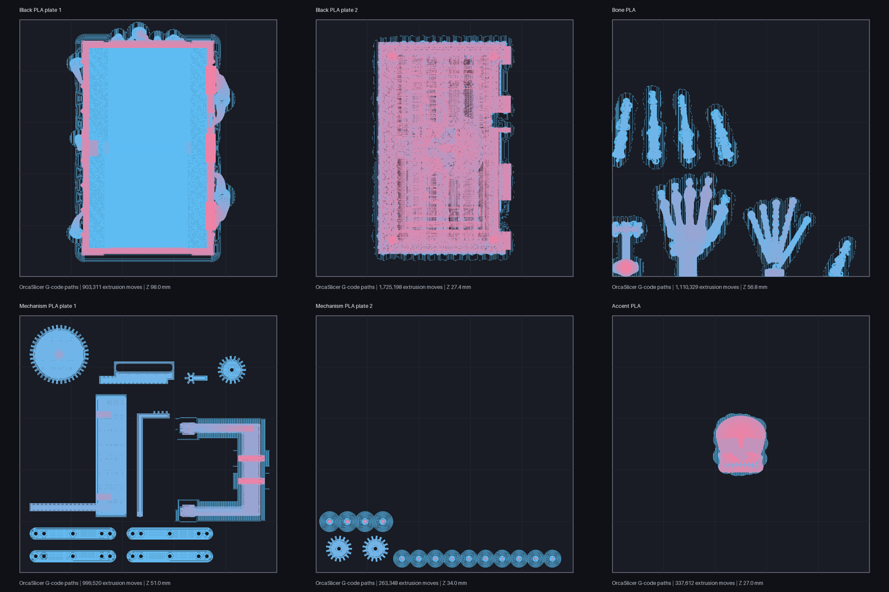

# The Ghoul's Grip – OrcaSlicer-Druckvalidierung

Status: **VERIFIED**

Validiert: 2026-10-09

OrcaSlicer: **2.4.2**

## Profilvertrag

- Drucker: `Anycubic Kobra S1 0.4 nozzle`
- Düse/Schicht: 0,4 mm / 0,20 mm
- Prozess: `0.20mm Standard @Anycubic Kobra S1 0.4 nozzle`
- Filament: `Anycubic PLA @Anycubic Kobra S1 0.4 nozzle`
- Bett: `Textured PEI Plate`
- Starttemperaturen: 55/215 °C
- Eine reale Spule/Farbe je Projekt, kein Prime Tower
- Farben: Schwarz `#202124`, Knochenbeige `#D8C6A5`, Naturweiß `#F1EBDD`, Grau `#777777`

Alle sechs Platten wurden nacheinander mit der OrcaSlicer-CLI aus den gelieferten 3MF-Projekten gesliced. Es gibt keine Floating-region-, Out-of-bed-, Empty-layer- oder Invalid-toolpath-Warnung. Die gemessenen Gesamtwerte sind außerdem als `status=verified` in `Metadata/ghouls_grip_print_metadata.xml` der jeweiligen 3MF gespeichert.

## Ergebnisse

| Projekt / Platte | Inhalt | Schichten | Filament | Zeit | Vorschau |
| --- | --- | ---: | ---: | ---: | --- |
| Schwarz, Platte 1 | Schatulle | 490 | 281,73 g | 10 h 15 min 37 s | [PNG](images/ghouls-grip-slice-black-plate-1.png) |
| Schwarz, Platte 2 | Deckel | 137 | 174,59 g | 8 h 47 min 16 s | [PNG](images/ghouls-grip-slice-black-plate-2.png) |
| Knochenbeige | Unterarm, Handführung, Handfläche, fünf Finger | 284 | 65,65 g | 4 h 57 min 27 s | [PNG](images/ghouls-grip-slice-bone.png) |
| Mechanik, Platte 1 | 4 Arme, Schlitten, Folgejoch, Hubjoch, Ritzel, Deckeltrieb, Scherenrad | 344 | 128,45 g | 6 h 12 min 57 s | [PNG](images/ghouls-grip-slice-mechanism-plate-1.png) |
| Mechanik, Platte 2 | 2 Zwischenräder, 10 kleine und 4 große Pins | 170 | 9,76 g | 52 min 26 s | [PNG](images/ghouls-grip-slice-mechanism-plate-2.png) |
| Grau | Direkter Totenkopf-Drehknopf | 135 | 22,02 g | 1 h 17 min 03 s | [PNG](images/ghouls-grip-slice-accent.png) |
| **Gesamt** | **38 Druckobjekte** | – | **682,20 g** | **32 h 22 min 46 s** | – |

Projektmetadaten:

| Projekt | Zeit | Masse | Länge | Volumen | Platten |
| --- | ---: | ---: | ---: | ---: | ---: |
| Schwarz | 68.573 s | 456,32 g | 152.995,37 mm | 367.990 mm³ | 2 |
| Knochenbeige | 17.847 s | 65,65 g | 22.012,91 mm | 52.950 mm³ | 1 |
| Mechanik | 25.523 s | 138,21 g | 46.339,59 mm | 111.460 mm³ | 2 |
| Grau | 4.623 s | 22,02 g | 7.381,35 mm | 17.750 mm³ | 1 |

Das schwarze Projekt benötigt 456,32 g statt der ursprünglichen 629,66 g. Einsparung: **173,34 g / 27,5 %**. Die sichtbare Außenseite bleibt geschlossen; die Schlittenführung erzeugt keinen äußeren Schlitz.

## Stützen und Objekt-Overrides

- Schatulle/Deckel: 3 Wände, 10 % Gyroid, Baumstützen nur an kritischen Regionen.
- Mechanik: 5 Wände, 40–100 % Infill; Arme, Zahnräder und Pins verstärkt; Stützen objektbezogen.
- Hand/Knochen: 4 Wände, 25 %; organische Überhänge mit bettgebundenen Baumstützen.
- Finger: 2 Wände, 15 %, 30 mm/s Außenwand und reduzierte Beschleunigung für die 0,8-mm-PLA-Flexuren.
- Totenkopfknopf: 5 Wände, 40 %, supportfrei in der gespeicherten Druckorientierung.

## Behobene Probleme

1. 3MF-Build- und Komponenten-Transformationen sowie Orcas `plater_id` werden vom Canvas berücksichtigt; Objekte liegen nicht mehr übereinander.
2. Die interne Führung besitzt eine 1,8-mm-Außenabdeckung; außen bleibt die Kiste geschlossen.
3. Die Mechanikplatte wurde kompakt in zwei vollständige 250-mm-Platten gepackt. Alle 27 naturweißen Mechanikobjekte sind genau einmal zugeordnet.
4. Der frühere Hebel, Rastschieber, die Spule, Schlüssel, Bandanker, Seile, Gummibänder und Federn sind entfernt. Der graue Totenkopf dreht direkt die Ritzelwelle.
5. `scripts/render_gcode_preview.py` akzeptiert Orcas führungslose Dezimalwerte wie `E.11915`, sodass auch die zweite Mechanikplatte korrekt gerendert wird.

## Dateibelege

| Datei | SHA-256 |
| --- | --- |
| `ghouls-grip-master.3mf` | `3CAC167C7DFEF2111CE30787AA96F7E815A2518E4C276E1683593BF42C53616A` |
| `ghouls-grip-master-retracted.3mf` | `390BA45EED92D471E6C1504089B7F530A9CB9E628C3CDA3B007214365E171115` |
| `ghouls-grip-print-black-pla.3mf` | `E73DDD1083EE963DAC398CC8A8510150647E551EE9D20693E330142B193A3A3E` |
| `ghouls-grip-print-bone-pla.3mf` | `FAF0063578353C36C055A8A4A3322418150AE7A31BB717632A0F3B18B659A22E` |
| `ghouls-grip-print-mechanism-pla.3mf` | `77444D4071715E6D109120D7F0E90E8F07CDAAB12539A22DDDB4CDD16DA9627C` |
| `ghouls-grip-print-accent-pla.3mf` | `4A4AC2BC1EC6337A4DB29E8AEEA1F815DA52EF4A136980D5166A892FEE274FD2` |

## Physische Restrisiken

- Der direkte Totenkopf hat weniger mechanische Hebelwirkung als der verworfene lange Hebel. Passungen und Zahnflanken vor der Endmontage entgraten.
- Erfolgreiches Slicen und die kollisionsfreie Simulation ersetzen keinen realen Dauerlauf.
- Gedruckte Pins sowie PLA-Flexuren verschleißen. Hoch belastete Scherengelenke vorzugsweise mit M3×16-Schrauben sichern.
- Vor dem Komplettdruck bleiben Arm-/Pin-/Zahnrad-Passungscoupon und ein einzelner Finger-Testdruck empfohlen.
