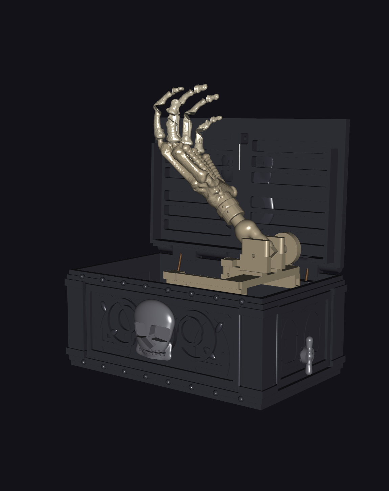

# The Ghoul's Grip - Maße, Bauanleitung und Sicherheitskonzept

## Status und Konstruktionsweg

Parametrischer Funktionsprototyp, kein getestetes Kinderspielzeug. Jedes Teil
entsteht aus einem Skript in `scripts/`; die STL-Dateien unter `models/` sind
reine Ausgaben und werden nie von Hand bearbeitet.

| Baugruppe | Skript |
| --- | --- |
| Gotische Schatulle und Deckel | `scripts/gothic_chest.py` |
| Hubwerk, Klinke, Kurbel, Unterarm | `scripts/mechanism.py` |
| Totenkopf und Totenkopf-Auslöser | `scripts/skull.py` |
| Skeletthand | `scripts/skeleton_hand.py` (+ `extract_hand_bones.py`) |
| Zusammenbau, STL/3MF-Ausgabe | `scripts/ghouls_grip.py` |
| Kobra-S1-Materialprojekte | `scripts/export_ghouls_grip_orca_projects.py` |
| Bewegungs-/Kollisionsnachweis | `scripts/verify_ghouls_grip_mechanics.py` |
| Montage-Renderings | `scripts/render_ghouls_grip.py` |

Die Skeletthand ist **kein Freihandmodell**: Die 27 Handknochen stammen aus
einem anatomischen CT-Datensatz (siehe Abschnitt *Lizenz*), werden automatisch
geclustert, klassifiziert, in einen kanonischen Frame gedreht, dezimiert und
dann zu druckbaren Teilen verschmolzen.

Die beiden KI-Konzeptbilder unter `model-sources/ghouls-grip/` liefern nur Stil
und Bewegungsablauf. Die Bemaßungen im Blueprint-Bild (396/377/330/255 mm)
widersprechen der Aufgabenbeschreibung und wurden nicht verwendet.

## Maßvertrag

| Merkmal | Wert | Herkunft | Sicherheit |
| --- | ---: | --- | --- |
| Außenmaß geschlossen | 200 × 120 × 110 mm | Benutzerangabe | hoch |
| Grundkörper (ohne Dekor) | 200 × 120 × 86 mm | abgeleitet | hoch |
| Grundkörper mit Dekor/Scharnier | 209,2 × 131,4 × 98 mm | am Mesh gemessen | hoch |
| Deckel | 206 × 129 × 27,5 mm | am Mesh gemessen | hoch |
| Wand/Boden | 3,0 mm | Benutzerangabe | hoch |
| Innenraum | 194 × 114 × 80 mm | Benutzerangabe | hoch |
| Scherenarm | 72 mm Pivotabstand, 12 × 4 mm | kompakter Funktionsumbau | hoch |
| Scherenbohrung | 3,2 mm | Benutzerangabe | hoch |
| Sehnenkanal | 2,0 mm | Benutzerangabe | hoch |
| Flexursteg | 0,8 mm | Benutzerangabe | mittel; PLA-Filmscharnier |
| Gleitpassung `FIT` | 0,40 mm | Druckerprofil-Basiswert | mittel |
| Handfläche | **67,3 × 94,2 × 25,2 mm** | anatomisch, siehe unten | hoch |

### Abweichung: Handfläche

Vorgegeben waren 50 × 45 mm. Eine echte Mittelhand mit acht Handwurzelknochen
und fünf Mittelhandknochen lässt sich darauf nicht abbilden, ohne dass das Teil
wie ein Brett statt wie ein Skelett aussieht. Die Hand läuft deshalb mit
`HAND_SCALE = 0,72` (ca. 72 % einer erwachsenen Hand) und wird 67 × 94 mm.
Das passt weiterhin in den 194 × 114 mm großen Innenraum.

### Abweichung: Hubweg

Die kompakte Schere hebt das Hubjoch um **48,2 mm** (22,2 → 70,4 mm
Scherenhöhe). Weil Unterarm und Hand erst nach vollständiger Deckelöffnung in
die Präsentationslage schwenken, erreichen die Fingerspitzen **246,7 mm über
der Aufstellfläche**, also rund **145 mm über dem geschlossenen Deckel**. Der
Effekt bleibt erhalten, obwohl Schere und Hubjoch deutlich kleiner sind.

## Kinematik und vollständiger Kraftpfad

1. Zwei Gummibänder ziehen den Schlitten nach links und treiben damit die
   beiden Scherenpaare an.
2. Der mittige Totenkopf drückt durch die 4,4-mm-Führungsbohrung auf die
   Rampe des vollständig innenliegenden Rastschiebers. Der Schieber hebt sich
   12 mm und zieht seine Rastzunge bei x = 68,5 mm aus der Schlittennut.
3. Derselbe Rastschieber gibt die innen geführte Deckelschlaufe frei. Zwei
   kurze Gummibänder an der
   Rückkante öffnen den Deckel schnell auf 92°, bevor die Hand aufrichtet.
4. Während der ersten 28,7 mm Hub bleibt der Unterarm um 105° gefaltet. Danach
   wird das vorbereitete Spiel im Steuerseil aufgebraucht; die restlichen
   19,5 mm Hub wickeln das Seil von der Ø27,7-mm-Sektorscheibe ab und schwenken
   den Unterarm zwangsgeführt bis zur nach links geneigten Endlage von
   -45°. Die Hand ist am Spigot fest um -75° gerollt, sodass die gekrümmte
   Handfläche nach oben zeigt und Süßigkeiten aufnehmen kann.
5. Eine Spule hinter der rechten Innenwand ist über ein vollständig
   innenliegendes 0,8-mm-Rückholseil mit dem Schlitten verbunden. Zum Spannen
   wird der flache Knochen-Schlüssel auf den 4-mm-Vierkant gesteckt und danach
   wieder abgezogen. Aufwickeln zieht den Schlitten zurück nach rechts, faltet
   die Hand und lässt die Klinke wieder einrasten.

Maßgebliche Daten:

- Armlänge L = 72 mm, Mittelpivot bei 36 mm.
- Fester Bodendrehpunkt: **x = 0 mm, z = 8 mm**; Scherenpaare bei y = ±40 mm.
- Eingefahren θ = 18°; ausgefahren θ = 78°.
- Schlittenweg x = +68,5 → +15,0 mm (**53,5 mm**).
- Kompaktes offenes Hubjoch: **82 × 92 mm**; der zentrale Handraum bleibt frei.
- Unterarmscharnier: Weltposition x = 61 mm; z = 60,2 → 108,4 mm.
- Unterarm-Endlage: **-45°** nach links; feste Handgelenk-Rollung **-75°** mit nach oben gerichteter Handfläche.
- Deckelscharnier: X-Achse an der langen Rückkante, y = 61 mm, z = 93 mm;
  federgeöffnet und durch Fangband auf 92° begrenzt.
- Spulenwelle in der rechten Seitenwand bei **(+100, 0, 30) mm**; Spule und
  Seil liegen innen, der abnehmbare Schlüssel steht aufgesteckt nur 9,6 mm vor.
- Der 5,5-mm-Totenkopf-Stößel endet in Ruhe 1,3 mm vor der Rastschieberrampe;
  der 13-mm-Schädelkopf liegt vollständig außerhalb der Frontwand.
- Eingefahrene Hand: 0,19 mm kleinster Innenraumrand und 11,91 mm Abstand zur
  geschlossenen Deckelunterseite.
- Nachgewiesene Schnittvolumen über den vollständigen Sweep: Deckel/Gehäuse,
  Hand/Gehäuse, Hand/Deckel, Hand/Hubjoch, Hand/Scherenarme und
  Klinke/Schlitten jeweils **0,000 mm³**.
- Der Deckel sitzt auf einer offenen U-Führung statt auf einem geschlossenen
  Rechteckzapfen. Dadurch kann die Vorderkante aus dem Gehäuse ausschwenken;
  definierte Taschen halten Scharnierlager und Seilführung frei.
- Schlitten, Scherenarme, Rastschieber, Führung, Antriebsbänder und Rückholseil
  verlassen den Gehäusekörper in keiner der 13 geprüften Stellungen.
- Benachbarte Phalangen und alle fünf Fingersockel zur Handfläche:
  **0,000 mm³** Schnittvolumen. Die sichtbaren Gelenkspalten sind real; nur der
  definierte PLA-Flexursteg verbindet die Segmente.

## Sicherheitskonzept

- Die Hand ist eine **kraftbegrenzte Greifbewegung**, keine Schnappfalle. Die
  Finger werden von einer Sehne gezogen und schließen sich um Süßigkeiten,
  ohne um Finger zuzuschnappen.
- Zwei Haushaltsgummibänder treiben nur den Hub an. Mit **einem** Band je Seite
  beginnen und die Vorspannung erst nach einem Leerlauftest erhöhen.
- Der Deckel braucht ein Fangband auf höchstens 92° Öffnungswinkel.
- Alle Quetschstellen der Schere bleiben im Gehäuse.
- Nicht unbeaufsichtigt an Kinder geben, nicht auf Gesicht oder Augen richten.

## Stückliste (20 Teiltypen / 33 physische Druckobjekte)

Die Einzelteile liegen ausschließlich in zehn Druck-3MFs für fünf
PLA-Farben/Spulen. Die fünf stützpflichtigen Mechanikteile erhalten jeweils
eine eigene kleine Platte, weil OrcaSlicers Kollisionsprüfung bei gemeinsamer
Anordnung überlappende Stützbahnen nachgewiesen hat. Redundante Einzel-STLs
werden nicht mehr ausgeliefert. Alle Teiltypen werden beim Erzeugen
in-memory auf Wasserdichtheit, konsistente Wicklung und degenerierte Flächen
geprüft.

| Teil im Materialprojekt | Anzahl | Maße (mm) | Material |
| --- | ---: | --- | --- |
| Schatulle | 1 | 209,2 × 131,4 × 98,0 | PLA schwarz |
| Deckel | 1 | 206,0 × 129,0 × 27,5 | PLA schwarz |
| Scherenarm | 4 | 84 × 12 × 4 | PLA naturweiß |
| Schlitten | 1 | 30 × 119,2 × 26 | PLA naturweiß |
| Hubjoch | 1 | 82 × 92 × 51 | PLA naturweiß |
| Rastschieber | 1 | 81 × 15 × 44 | PLA naturweiß |
| Interne Rastschieberführung | 1 | 102,5 × 22,9 × 34 | PLA naturweiß |
| Interne Seilspule | 1 | 24 × 24 × 29 | PLA naturweiß |
| Abnehmbarer Knochen-Schlüssel | 1 | 32,3 × 14 × 6,6 | PLA naturweiß |
| Bandanker | 1 | 14 × 110 × 25,5 | PLA naturweiß |
| Unterarm mit Sektorscheibe | 1 | 27,7 × 47 × 56,9 | PLA knochenfarben |
| Pivot-Pin klein | 8 | Ø6,2 × 26 | PLA naturweiß |
| Pivot-Pin groß | 4 | Ø7,2 × 34 | PLA naturweiß |
| Flacher Totenkopf-Auslöser | 1 | 42,2 × 47,9 × 21,5 | PLA grau |
| Handfläche | 1 | 67,9 × 96,5 × 25,2 | PLA knochenfarben |
| Sehnenführung | 1 | 62,0 × 77,4 × 25,0 | PLA knochenfarben |
| Daumen | 1 | 19,3 × 35,6 × 11,5 | PLA knochenfarben |
| Zeigefinger | 1 | 17,4 × 56,7 × 10,5 | PLA knochenfarben |
| Mittelfinger | 1 | 12,2 × 65,9 × 10,8 | PLA knochenfarben |
| Ringfinger | 1 | 15,4 × 61,9 × 10,3 | PLA knochenfarben |
| Kleinfinger | 1 | 19,0 × 46,0 × 9,0 | PLA knochenfarben |

Zusätzliche Lieferdateien:

- `models/ghouls-grip-master.3mf` - ausgefahrene, zusammengebaute
  Master-Materialansicht.
- `models/ghouls-grip-master-retracted.3mf` - geschlossene Einbaukontrolle.
- `models/ghouls-grip-preview.stl` - Montagevorschau für das STL-Canvas.
- `models/ghouls-grip-print-black-pla.3mf` - Gehäuse/Deckel, zwei Orca-Platten.
- `models/ghouls-grip-print-bone-pla.3mf` - Handfläche, Führung, Unterarm.
- `models/ghouls-grip-print-mechanism-pla.3mf` - supportfreie Mechanik inklusive
  4 Scherenarmen, Schlitten sowie 8 kleinen und 4 großen Pins.
- `models/ghouls-grip-print-mechanism-supported-{platform,latch-slider,latch-bracket,crank,band-anchor}-pla.3mf` - fünf Einzelplatten für Hubjoch, Rastschieber, interne Führung, Spule plus Schlüssel und Bandanker mit bettgebundenen, eng anliegenden Normalstützen.
- `models/ghouls-grip-print-accent-pla.3mf` - grauer Totenkopf-Auslöser.
- `models/ghouls-grip-print-fingers-pla.3mf` - fünf Finger mit
  0,8-mm-Filmscharnieren und automatischen, nur vom Druckbett ausgehenden
  Baumstützen für die organischen Unterseiten.

Das gesamte Modell ist auf **reines PLA** ausgelegt. TPU und PETG werden nicht
benötigt; alle zehn Druckprojekte laufen mit demselben Filamenttyp und fünf
Farb-/Spulenzuordnungen. Wer PLA+ oder ASA vorrätig hat, kann die sechs
Mechanik-Projekte damit drucken - ASA braucht dann ein Gehäuse und 100/250 °C.

Die zehn Druckdateien sind echte OrcaSlicer-Projekte. Sie enthalten den
Drucker `Anycubic Kobra S1 0.4 nozzle`, `Textured PEI Plate`, das passende
Anycubic-Filamentprofil und globale Materialwerte. Das Mechanik-Projekt enthält
zusätzlich objektbezogene Verstärkungen für Arme, Klinke und Pins.

Nicht gedruckt: 2 × Haushaltsgummiband ca. 60 mm, ca. 1 m 0,8-mm-Angelsehne,
1,75-mm-Filament als Scharnierachse. Für hoch belastete Scherengelenke sind
M3×16-Schrauben mit selbstsichernden Muttern besser als die gedruckten Stifte.

## Empfohlene Druckeinstellungen

| Teil | Material | Wände/Infill |
| --- | --- | --- |
| Gehäuse/Deckel | PLA schwarz | 3 Wände, 10 % Gyroid |
| Schere/Schlitten/Klinke/Hubjoch | PLA naturweiß | 5 Wände, 40 % Gyroid |
| Scherenarme | PLA naturweiß | 5 Wände, 100 % |
| Gedruckte Pins | PLA naturweiß | 6 Wände, 100 % |
| Finger | PLA knochenfarben | 2 Wände, 15 % Gyroid, 30-50 mm/s |
| Hand, Unterarm, Totenkopf | PLA | 4 Wände, 25 % Gyroid |

Schichthöhe 0,20 mm, 0,4-mm-Düse, Textured PEI Plate.
`XY Hole Compensation` +0,10 mm, `XY Contour Compensation` 0 mm und
Elefantenfuß-Kompensation 0,15 mm sind in den Materialprojekten gespeichert.
Reliefs und Nieten der Schatulle sind 2,6-3,0 mm erhaben. OrcaSlicer 2.4.2
meldete bei Gehäuse, Deckel, organischen Knochenformen und fünf komplexen
Mechanikteilen dennoch schwebende Regionen. Gehäuse und Deckel verwenden
deshalb Baumstützen nur für kritische Bereiche; die organischen Teile nutzen
vollständige bettgebundene Baumstützen. Die supportfreie Mechanikplatte enthält
Arme, Schlitten und Pins.

Breite, nicht funktionale Wandfelder der Schatulle sind von innen auf eine
1,6-mm-Außenhaut erleichtert. Am Deckel ersetzen zwölf 10 mm breite Kanäle den
früher weitgehend massiven Mittelblock; Außenrahmen, Rippen, Scharnier, Fangband-
und Sitzflächen bleiben massiv. Die kurzen Kanaldecken sind als Brücken
ausgelegt, während OrcaSlicer nur Scharnier, Fangband und andere kritische
Überhänge stützt. Die 3-mm-tiefen inneren Schlittenführungen erhalten außen
eine 1,8-mm-Sockelabdeckung, damit kein horizontaler Durchbruch sichtbar ist.

Mit OrcaSlicer 2.4.2 erfolgreich geslicte Werte:

| Projekt/Platte | Schichten | Filament | Druckzeit | Stützen |
| --- | ---: | ---: | ---: | --- |
| Schwarz PLA, Platte 1 (Schatulle) | 490 | 282,25 g | 10 h 20 min | Baum, nur kritisch |
| Schwarz PLA, Platte 2 (Deckel) | 137 | 175,91 g | 8 h 50 min | Baum, nur kritisch |
| Knochen PLA | 284 | 53,21 g | 3 h 34 min | Baum |
| Mechanik PLA, supportfrei | 170 | 50,10 g | 2 h 31 min | nein |
| Hubjoch PLA | 344 | 46,21 g | 1 h 59 min | normal/snug |
| Rastschieber PLA | 344 | 8,94 g | 32 min | normal/snug |
| Rastschieberführung PLA | 170 | 18,93 g | 35 min | normal/snug |
| Spule + Schlüssel PLA | 165 | 5,73 g | 23 min | normal/snug |
| Bandanker PLA | 143 | 12,25 g | 40 min | normal/snug |
| Akzent PLA | 107 | 14,32 g | 51 min | Baum |
| Finger PLA | 57 | 12,01 g | 1 h 23 min | Baum |
| **Gesamt** | - | **694,09 g** | **31 h 14 min** | - |

Alle Projekte starten mit **55/215 °C** (PLA). Das Fingerprojekt fährt die
Außenwände bewusst mit 30 mm/s und reduzierter Beschleunigung, damit der
0,8 mm dünne Steg als zwei saubere Perimeter entsteht und nicht ausdünnt.
Die vollständige Slice-Evidenz steht in
[`ghouls-grip-druckvalidierung.md`](ghouls-grip-druckvalidierung.md).

## Montage

1. Je zwei 72-mm-Scherenarme zu einem X-Paar verbinden; zwei Paare bauen.
2. Untere Festpunkte auf die Bodenposten bei (0, ±40) stecken, die anderen
   unteren Enden mit dem Schlitten verbinden. Schlittenweg +68,5 → +15,0 mm
   trocken prüfen.
3. Das 82 × 92 mm große offene Hubjoch montieren: je ein oberes Ende in das
   feste Auge, das andere in die Kulisse. Der mittlere Handraum bleibt frei.
4. Die Rastschieberführung mit einer dünnen CA-/Epoxidschicht vollständig
   hinter der Frontinnenwand montieren. Zwei lokale Montagepads umgehen das
   nach innen ragende Relief und lassen 0,1 mm Klebefuge zur glatten Wand.
   Den Rastschieber von oben einsetzen und prüfen, dass seine Zunge bei
   x = 68,5 mm in die Schlittennut fällt. Der Totenkopfstift muss auf die
   interne Rampe drücken und den Schieber um 12 mm anheben; außen bleiben nur
   Totenkopf und schmale Führungsbohrung sichtbar.
5. Bandanker bei x = -76 mm montieren. Je ein Gummiband von y = ±40 zum
   jeweiligen Schlittenhaken legen. Mit minimaler Vorspannung beginnen.
6. Die Spule von innen einsetzen und ihre Welle durch die Ø6,4-mm-Bohrung bei
   (+100, 0, 30) führen. Ein 0,8-mm-Seil vom Schlittenauge zur internen Spule
   legen. Den abnehmbaren Knochen-Schlüssel außen auf den Vierkant stecken:
   Aufwickeln muss den Schlitten nach rechts in die Raststellung ziehen.
7. Unterarm mit der jetzt zur Y-Achse passenden Hauptgelenkbohrung in die
   Hubjoch-Ohren hängen. Steuerseil am Gehäuseauge (x = 72,2, y = 34, z = 18)
   befestigen, mit **28,7 mm Spiel** zur Sektorscheibe führen und aufwickeln.
   Erst nach vollständiger Deckelöffnung darf das Seil straff werden und den
   Unterarm bis zum -45°-Anschlag schwenken.
8. Handfläche und Sehnenführung um **-75°** gerollt auf den Unterarmspigot
   stecken, bis die schräg ausgerichteten 1,9-mm-Querbohrungen fluchten, und
   mit 1,75-mm-Filament sichern. In Endlage muss die Handfläche nach oben
   zeigen. Die fünf Fingersockel mit 1,0 mm Durchmesserspiel auf ihre
   beschrifteten Knöchelzapfen setzen. Kein Fingerknochen darf einen
   Nachbarknochen oder die Handfläche schneiden.
9. Fingersehnen von den Spitzen durch die Führung zum Jochauge führen. So
   einstellen, dass die Finger im letzten Drittel des Hubs schließen.
10. Deckel mit 1,75-mm-Filamentstift montieren. Je ein Öffnungsband zwischen
    den hinteren Gehäuseaugen und Deckellaschen einhängen. Die vordere
    Deckelschlaufe am Rastschieber einhängen und ein Fangband auf 92° einstellen.
11. Ohne Süßigkeiten prüfen: Totenkopf drücken → Deckel öffnet zuerst → Schere
    hebt → Unterarm schwenkt nach links und präsentiert die Handfläche nach oben
    → Finger schließen. Danach mit der rechten
    aufgesteckten Schlüssel zurückspannen, den Schlüssel abziehen; die Hand
    muss vollständig verschwinden und der Deckel ohne Druck schließen.

## OrcaSlicer-Ablauf

1. `models/ghouls-grip-master.3mf` nur zur Montage- und Materialkontrolle öffnen.
2. Zum Drucken die passende Material-Projektdatei öffnen. Drucker, Textured
   PEI Plate, Filament, 0,20-mm-Prozess und Objekt-Overrides sind bereits
   eingebettet; vor dem Slicen trotzdem Düsendurchmesser und reale Spule prüfen.
3. Das schwarze PLA-Projekt enthält wegen der Bettgröße zwei Platten. Alle
   anderen Materialprojekte sind jeweils auf einer Platte angeordnet.
4. Alle zehn Projekte drucken PLA; es werden fünf Farben/Spulen verwendet.
   Finger und organische Knochenformen erhalten nur bettgebundene Stützen;
   die Finger werden zusätzlich langsam gedruckt.
5. Vor dem Gesamtdruck einen Arm, einen Pin und ein Fingerglied als
   Passungsmuster slicen. Keines der Projekte startet oder sendet einen Druck.

## Offene Testdruck-Risiken

- Der rechnerisch kleinste Innenraumrand der eingeklappten Hand beträgt
  **0,19 mm**; zur Deckelunterseite bleiben **11,91 mm**. Der Kollisionsnachweis ist geometrisch bestanden, aber
  Drucktoleranzen und Sehnenspiel erfordern einen Einbau-/Stow-Test vor dem
  endgültigen Deckelanschlag.
- Die Gummibandlänge von ca. 60 mm ist nur das ungespannte Kaufmaß;
  Vorspannung und Hebelarm müssen am Prototyp ermittelt werden.
- Deckel- und Unterarmsequenz sind geometrisch gekoppelt; die Fingerbeugung
  bleibt über die fünf Sehnenlängen einstellbar. Das 28,7-mm-Spiel des
  Unterarm-Steuerseils muss beim Prototyp exakt übernommen werden.
- Die 0,8-mm-Filmscharniere sind die Schwachstelle der Hand. PLA erlaubt dort
  nur wenige hundert Zyklen; die Finger sind bewusst als Verschleißteil
  ausgelegt und einzeln nachdruckbar. Wer später doch TPU 95A bekommt, kann
  allein `ghouls-grip-print-fingers-pla.3mf` auf ein TPU-Filament umstellen.
- Gedruckte Pins in PLA sind für Dauerbetrieb grenzwertig. Für die vier
  hochbelasteten Scherengelenke sind M3×16-Schrauben die bessere Wahl.

## Lizenz der Knochengeometrie

Die 27 Handknochen stammen aus **"Wrist Bones Full Hand - Human Skeleton"**,
NIH 3D Print Exchange, Modell `3DPX-016815`, hochgeladen von *My Segmenter*
(mysegmenter.com), lizenziert unter **CC BY 4.0**.

| Kandidat | Quelle | Lizenzentscheidung | Verwendung |
| --- | --- | --- | --- |
| Wrist Bones Full Hand - Human Skeleton | [NIH 3D, 3DPX-016815](https://3d.nih.gov/entries/3DPX-016815) | CC BY 4.0; Bearbeitung und Weitergabe mit Namensnennung zulässig | **Hybrid**: anatomische, nicht fitkritische Knochenformen werden wiederverwendet; Sockel, Flexuren, Sehnenführung und alle Mechanikanschlüsse werden parametrisch neu gebaut |
| Anonyme Marktplatz-/Spieldateien | keine belastbare Originalquelle | unklare oder inkompatible Lizenz | verworfen |

Im Repository liegt nur der abgeleitete, klassifizierte und dezimierte Datensatz
`model-sources/ghouls-grip/reference/hand_bones.npz`. Die 12 MB große
Original-STL wird von `scripts/extract_hand_bones.py` bei Bedarf neu geladen und
nicht eingecheckt. Bei Weitergabe der Modelle muss die CC-BY-Nennung erhalten
bleiben.

### Python-/Blender-Routing

Blender wird als **visuelle und organische Arbeitsumgebung**, aber nicht als
Quelle der fitkritischen Mechanik eingesetzt. Die exakte Master-3MF wird durch
`scripts/build_ghouls_grip_blender_scene.py` reproduzierbar in
`model-sources/ghouls-grip/ghouls-grip-master.blend` importiert. Darin sind
19 technische Objekte in `frozen_technical` gesperrt; 11 Hand-, Unterarm- und
Schädelobjekte liegen getrennt in `organic_approved`.

Die Blender-CLI baut die Basisszene, rendert und übernimmt reproduzierbare
Batch-Operationen. Der offizielle Blender-Lab-MCP dient zusätzlich zur
interaktiven Szenenprüfung und zu kleinen, freigegebenen visuellen Änderungen.
Python bleibt Quelle der Wahrheit für Maßstab, Knochenausrichtung, Flexursteg,
Sockel, Sehnenkanäle, Gelenke, Freiräume und die vollständige Mechanik. Nach
jeder Blender-Geometrieänderung müssen Mesh, Bounds, Komponenten und eingefrorene
Datums erneut geprüft werden.
